# Aplastic anemia

**درس:** هماتولوژی  
**مبحث:** Aplastic anemia و نارسایی مغز استخوان  
**تاریخ تولید جزوه:** 2026-11-05T11:46:24

## ۱. مقدمه و کلیات

در جلسهٔ قبل، نگاه بالینی به کم‌خونی‌ها و دسته‌بندی آن‌ها با CBC و MCV بررسی شد. خستگی زودرس، نفس‌نفس‌زدن و تپش قلب از تظاهرات کم‌خونی‌اند و وجود ایکتر به نوع کم‌خونی بستگی دارد؛ در کم‌خونی همولیتیک، زردی ممکن است در ملتحمه و گاهی روی پوست شکم یا ران کودکان دیده شود. Reticulocyte Production Index (RPI) نیز در افتراق کمک می‌کند: در کم‌خونی میکروسیتیک و هیپوکروم همراه با RPI پایین، ابتدا Iron deficiency مطرح است؛ با RPI بالا، تالاسمی‌ها و هموگلوبینوپاتی‌های همولیتیک مطرح می‌شوند. برآورد جهانی WHO که در جلسهٔ قبل ذکر شد، حدود ۱٫۶ تا ۱٫۷ میلیارد فرد مبتلا به کم‌خونی را نشان می‌داد.

این جلسه به Aplastic anemia (AA)، بررسی و cellularity مغز استخوان، معیارهای تشخیصی و درجه‌بندی شدت، تظاهرات بالینی، علل و پاتوفیزیولوژی acquired AA، تشخیص افتراقی و درمان اختصاص داشت؛ سپس inherited bone marrow failure، از جمله Fanconi anemia و سایر سندرم‌ها، بررسی شد.

## ۲. متن اصلی جزوه

### زمینه و تعریف Aplastic anemia

*تصویر 1*

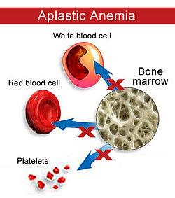
*تصویر 2*

در Aplastic anemia، bone marrow failure تولید رده‌های خونی را کاهش می‌دهد؛ در نتیجه WBC، RBC و platelets ممکن است همگی کاهش یابند.

*تصویر 3*

*تصویر 4*

در نام Aplastic anemia، «A» به معنای نفی است و «plastic» به رده‌های خونی اشاره دارد. یافتهٔ مشخص بیماری Pancytopenia همراه با نارسایی مغز استخوان است. هر سه ردهٔ WBC، RBC و platelets و تولید آن‌ها تحت‌تأثیر قرار می‌گیرند، گرچه ممکن است بیمار در ابتدا کاهش هم‌زمان هر سه رده را نداشته باشد. کاهش دو رده را bicytopenia می‌نامیم؛ اگر با یافته‌های دیگر هم‌خوان باشد، باید در ارزیابی بیمار در نظر گرفته شود.

> [BOX:DEFINITION]
> **Aplastic anemia**
> یک سندرم نادر bone marrow failure است که با Pancytopenia در غیاب infiltrate غیرطبیعی و بدون افزایش Reticulin تعریف می‌شود. کم‌خونی معمولاً normocytic یا macrocytic و normochromic است و با hypocellularity همراه می‌شود.

### کیس نمونه

*تصویر 5*

بیمار پسر ۱۱ساله‌ای است که مقادیر زیر برای او گزارش شده‌اند:

| شاخص | مقدار بیمار | Reference Interval در اسلاید |
|---|---:|---:|
| WBC | ۲٫۰ | ۴٫۵–۱۱٫۰ |
| Hb | ۷٫۹ | ۱۲٫۰–۱۵٫۰ |
| MCV | ۱۰۴ fL | ۸۰–۱۰۰ |
| Platelet | ۱۵ هزار | ۱۵۰–۴۵۰ |
| RBC | حدود ۲٫۲ میلیون در لیتر | — |

مقدار reticulocyte برابر ۰٫۶٪ گزارش شده است. مقدار دیگری برای reticulocyte حدود ۱۶، neutrophil حدود ۰٫۵ و lymphocyte حدود ۰٫۴ ذکر شده‌اند.

> [BOX:REVIEW]
> **مقادیر جدول کیس**
> چیدمان OCR جدول و واحد بعضی مقادیر، به‌ویژه مقادیر reticulocyte و شمارش differential، کاملاً روشن نیست؛ مقادیر قابل‌خواندن حفظ شده‌اند.
> **وضعیت:** نیازمند بررسی

با توجه به کاهش رده‌ها، بیمار Pancytopenia دارد. ANC حدود ۵۰۰ است؛ بنابراین، در معرض عفونت قرار دارد.

> [BOX:EXAMPLE]
> بیمار نمونه، پسر ۱۱ساله‌ای با کاهش WBC، Hb و platelet است؛ با توجه به کاهش رده‌ها، Pancytopenia دارد و ANC حدود ۵۰۰ او را در معرض عفونت قرار می‌دهد.

### بررسی bone marrow

#### محل نمونه‌گیری و ارزیابی پیش از procedure

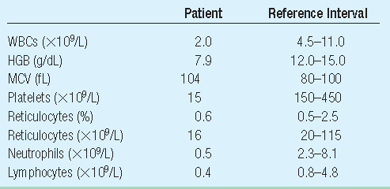
*تصویر 6*

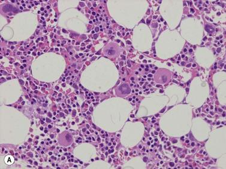
*تصویر 7*

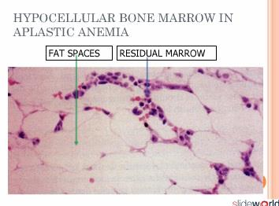
*تصویر 8*

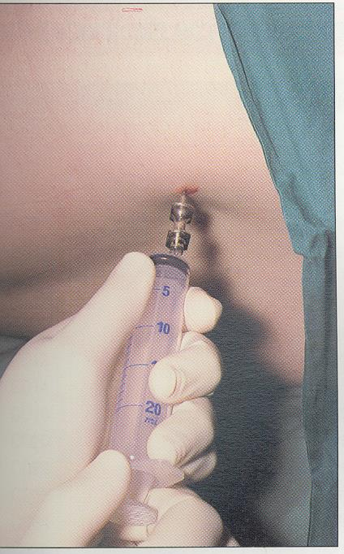
*تصویر 9*

Bone marrow examination دو بخش دارد: aspiration و biopsy. هر دو procedure نسبتاً ساده‌اند. در بزرگسالان، خون‌سازی عمدتاً در استخوان‌های پهن انجام می‌شود و محل مناسب نمونه‌گیری Posterior iliac crest است. برای یافتن محل، پشت لگن و برجستگی و فرورفتگی مجاور آن را لمس می‌کنند؛ نمونه‌گیری از ناحیهٔ نزدیک این fossa انجام می‌شود. در اسلاید، نمای hypocellular bone marrow در Aplastic anemia با فضاهای چربی و residual marrow نشان داده شده است.

پیش از procedure، کف دست‌ها معاینه می‌شود، کبد و طحال لمس می‌شوند و lymph nodeها، از جمله cervical، axillary و inguinal، بررسی می‌شوند. یافته‌های گزارش‌های ultrasound یا CT نیز در صورت وجود مرور و ثبت می‌شوند. درست پیش از procedure، CBC گرفته می‌شود.

محل نمونه‌گیری را با محلول صابونی یا بتادین رقیق پاک می‌کنند و پس از خشک‌شدن، با بتادین غلیظ ضدعفونی می‌کنند؛ گاهی از ابتدا بتادین غلیظ به‌کار می‌رود. با lancet برش کوچکی روی پوست ایجاد می‌کنند. سپس با دو سرنگ Xylocaine یا lidocaine، از زیر پوست تا سطح periosteum را به‌تدریج و در نقاط مختلف بی‌حس می‌کنند. periosteum عصب دارد، اما خود استخوان عصب ندارد. پس از حدود دو تا سه دقیقه، وسایل sterile pack آماده می‌شوند.

#### Aspiration

برای aspiration معمولاً از سوزن کوتاه‌تر و برای biopsy از سوزن بلندتر استفاده می‌شود. بیمار را با sterile drape می‌پوشانند و محل ورود سوزن را باز می‌گذارند. سوزن را از برش پوست عبور می‌دهند و پس از رسیدن به استخوان، با چرخاندن یا trephining به داخل آن نفوذ می‌کنند. هنگام ورود به marrow، مقاومت زیر دست کمتر می‌شود. guide داخل سوزن را بیرون می‌آورند و از ظاهر نمونه بررسی می‌کنند که سوزن وارد marrow شده باشد. نمونه ظاهری شبیه خون دارد، اما به پررنگی خون نیست.

سپس سرنگ ۲۰ یا ۵۰ سی‌سی را به holder وصل می‌کنند و آرام aspiration می‌کنند؛ معمولاً حدود ۱ تا ۱٫۵ سی‌سی مایع marrow گرفته می‌شود. بلافاصله از آن bone marrow smear تهیه می‌کنند، نه smear خون محیطی. بقیهٔ نمونه را به لولهٔ هپارین و لولهٔ EDTA منتقل می‌کنند تا برای مطالعات cytogenetic و کروموزومی و نیز flow cytometry استفاده شود. نمونه را سریع مخلوط می‌کنند، زیرا marrow زودتر از خون لخته می‌شود.

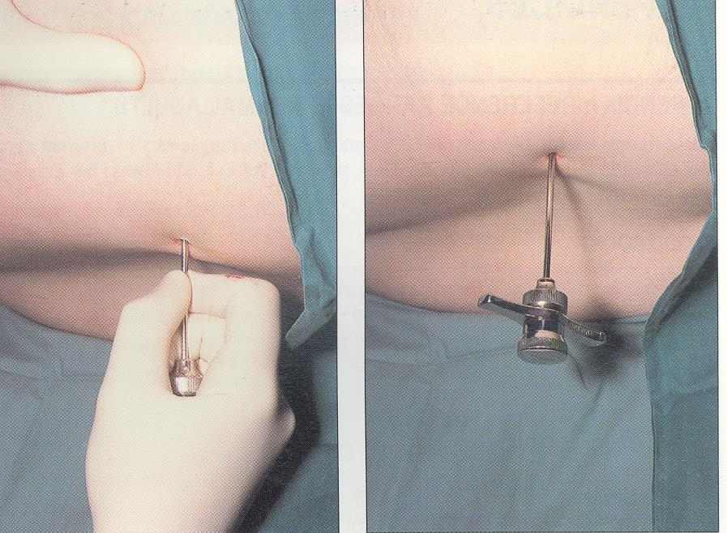
*تصویر 10*

اسلاید BM Aspiration به مقالهٔ Rev Med Hosp Gen Mex. 2015;78:196-201 ارجاع می‌دهد.

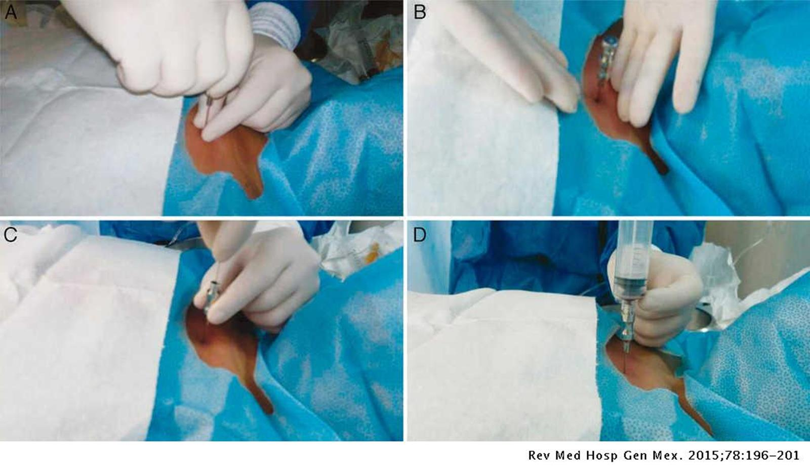
*تصویر 11*

#### Biopsy و مراقبت پس از procedure

در برخی guidelineها ترتیب انجام تغییر کرده و پیشنهاد می‌شود biopsy پیش از aspiration انجام شود تا شمارش سلولی و یافته‌ها پیش از اثر استرس نمونه‌گیری ارزیابی شوند. biopsy معمولاً توسط pathologist انجام می‌شود. با trephining، حدود یک سانتی‌متر از نمونهٔ marrow را داخل سوزن می‌آورند و برای آزادکردن نمونه، سوزن را در جهت مخالف می‌چرخانند؛ سپس آن را آرام آزاد می‌کنند تا قطعهٔ بافت کنده نشود.

نمونه را با بیرون‌آوردن guide از انتهای سوزن خارج می‌کنند، روی گاز استریل می‌گذارند و اسلاید تمیز را با آن تماس می‌دهند؛ این کار touch smear نام دارد و برای تشخیص بدخیمی‌های خونی، به‌ویژه در موارد مشکوک به metastasis، کمک‌کننده است. نمونهٔ biopsy که ترکیبات استخوانی دارد، ابتدا در اسید نیتریک قرار می‌گیرد تا استخوان حل شود؛ سپس fixation و قرارگرفتن در پارافین انجام می‌شود تا برای برش‌های پاتولوژی آماده شود.

پس از procedure، محل پانسمان می‌شود و به بیمار گفته می‌شود تا ۴۸ ساعت حمام نرود و محل را خیس نکند. اگر حال بیمار خوب باشد، می‌تواند برود.

### Cellularity مغز استخوان

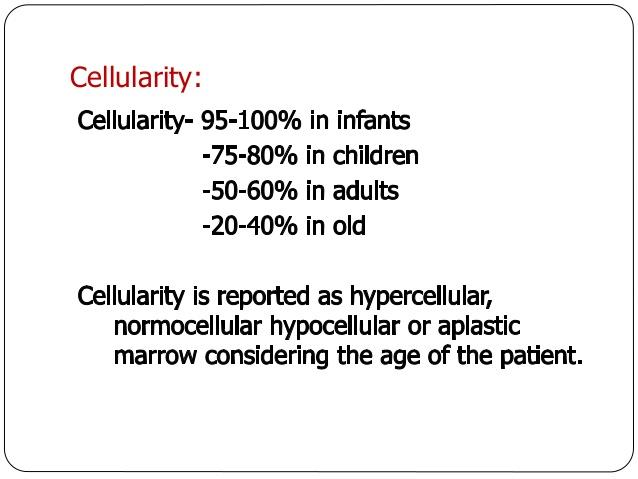
*تصویر 12*

Cellularity مغز استخوان وابسته به سن است و نسبت سلول‌های hematopoietic به کل سلول‌های مغز استخوان را نشان می‌دهد. در بررسی با low power، سلول‌های خون‌ساز میان فضاهای سفیدرنگی دیده می‌شوند که عمدتاً سلول‌های چربی‌اند؛ سلول‌های چربی و hematopoietic در تعادل‌اند. با افزایش فعالیت مغز استخوان، سلول‌های چربی کمتر و سلول‌های خون‌ساز بیشتر می‌شوند. در thalassemia major، سلول‌های خون‌ساز فراوان‌اند و سلول چربی اندک است؛ در Aplastic anemia، با کاهش خون‌سازی، فضای چربی بیشتر می‌شود.

> [BOX:DEFINITION]
> **Cellularity مغز استخوان**
> نسبت سلول‌های hematopoietic به کل سلول‌های مغز استخوان است و وابسته به سن است.

اسلاید برای cellularity معمول، مقادیر زیر را ذکر می‌کند:

| گروه سنی | Cellularity معمول در اسلاید |
|---|---:|
| نوزادان | ۹۵–۱۰۰٪ |
| کودکان | ۷۵–۸۰٪ |
| بزرگسالان | ۵۰–۶۰٪ |
| سالمندان | ۲۰–۴۰٪ |

تفسیر hypercellular، normocellular، hypocellular یا aplastic بودن باید با توجه به سن انجام شود.

در توضیح شفاهی، cellularity در نوزادان حدود ۸۵–۱۰۰٪ و در برخی موارد تا ۱۰۰٪ بیان شد. همچنین، مقادیر خلاصهٔ زیر برای گروه‌های سنی ذکر شدند:

| گروه سنی | Cellularity در توضیح شفاهی |
|---|---:|
| نوزادان | حدود ۸۵–۱۰۰٪؛ در برخی موارد تا ۱۰۰٪ |
| زیر ۲۰ سال | ۴۵–۸۵٪ |
| ۲۰ تا ۴۰ سال | ۴۰–۷۰٪ |
| ۴۰ تا ۶۰ سال | ۳۵–۶۵٪ |
| بالای ۶۰ سال | معمولاً کمتر از ۳۰٪ در نظر گرفته نمی‌شود |

در همان توضیح، حدود ۳۰٪ به‌عنوان نقطهٔ بحرانی مطرح شد.

> [BOX:REVIEW]
> **دامنه‌های cellularity برحسب سن**
> دامنه‌های اسلاید و گفتار برای گروه‌های سنی یکسان نیستند؛ هر دو مجموعهٔ اعداد حفظ شده‌اند و باید مشخص شود کدام مرجع یا روش سنی مدنظر درس است.
> **وضعیت:** نیازمند بررسی

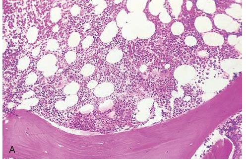
*تصویر 13*

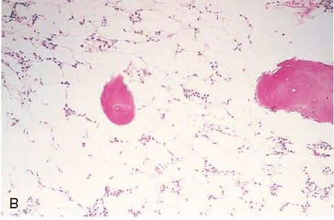
*تصویر 14*

در تصاویر، نمونهٔ طبیعی bone marrow با نمونهٔ AA مقایسه می‌شود. در H&E، فضاهای چربی رنگ نمی‌گیرند. نمونهٔ دیگری cellularity حدود ۵–۱۰٪ دارد و در آن تنها به‌ندرت سلول چربی و عمدتاً سلول‌های خون‌ساز دیده می‌شود؛ این مقدار در مقایسه با حد بحرانی مطرح‌شده پایین است. در biopsy ساختار کلی marrow بررسی می‌شود، اما aspiration نمونه‌ای برای smear و مشاهدهٔ مورفولوژی سلول‌ها فراهم می‌کند.

> [BOX:EXAMPLE]
> در مقایسهٔ تصاویر، نمونهٔ AA با cellularity حدود ۵–۱۰٪ نشان داده شده است؛ در آن تنها به‌ندرت سلول چربی و عمدتاً سلول‌های خون‌ساز دیده می‌شوند.

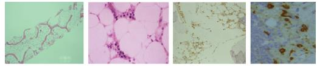
*تصویر 15*

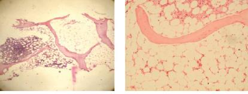
*تصویر 16*

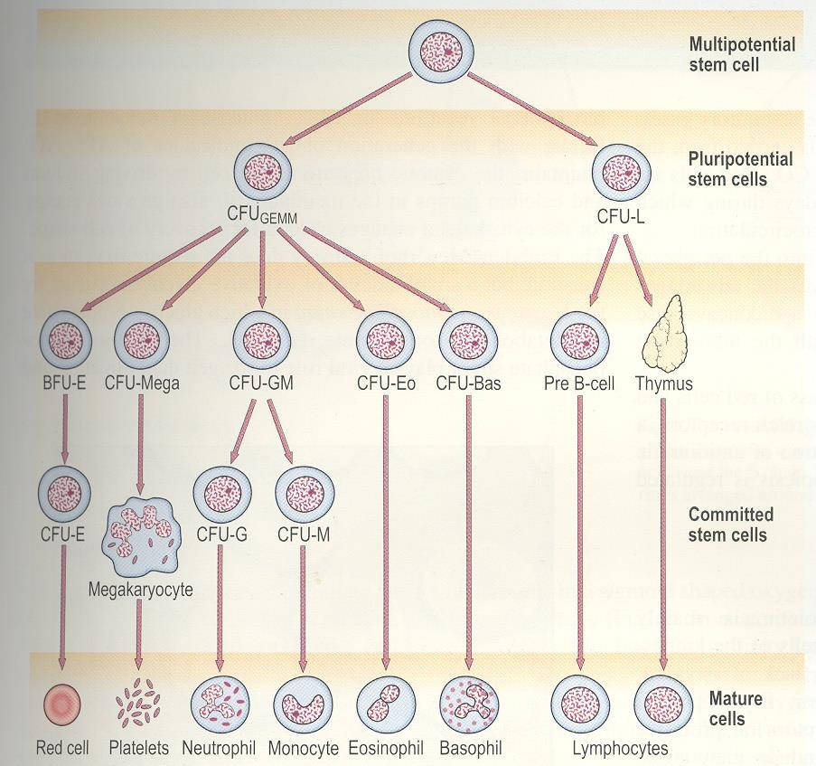
*تصویر 17*

نمودار، خون‌سازی stem cellهای pluripotential و committed stem cellها و شاخه‌های Pre-B cell، thymus، platelets، neutrophil، monocyte، eosinophil، basophil و lymphocyte را نشان می‌دهد.

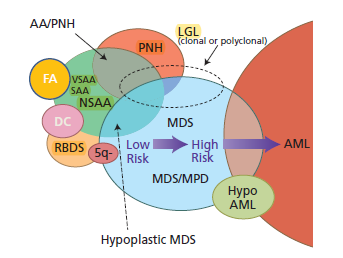
*تصویر 18*

### تشخیص و درجه‌بندی شدت

#### معیارهای تشخیصی

برای تشخیص AA، اسلاید cellularity مغز استخوان کمتر از ۲۵٪ را همراه با موارد زیر فهرست می‌کند:

- granulocyte کمتر از ۱۵۰۰؛
- platelet کمتر از ۱۰۰٬۰۰۰؛
- anemia با Hb کمتر از ۱۰ g/dL و reticulocyte کمتر از ۱٪؛
- نبودن سلول غیرطبیعی و Reticular fibers.

اسلاید این مجموعه را در عنوان «mild to moderate AA» نیز می‌آورد و می‌گوید ممکن است یک رده بیش از بقیه درگیر شود. در طبقه‌بندی شدت، معیارهای دقیق‌تری برای SAA و VSAA مطرح‌اند؛ بنابراین، این آستانه‌های تشخیصی و معیارهای شدت را نباید بدون توجه به تفاوت کاربردشان یکی فرض کرد.

*تصویر 19*

AA بیماری heterogenous است و بر اساس شدت Pancytopenia درجه‌بندی می‌شود. در توضیح گفتاری، معیارهای زیر ذکر شدند:

- **Minimal AA:** neutrophil کمتر از ۱۵۰۰، platelet کمتر از ۵۰ هزار، Hb کمتر از ۱۰ و reticulocyte کمتر از ۱٪.
- **Severe:** neutrophil کمتر از ۵۰۰، platelet کمتر از ۲۰ هزار و Hb کمتر از ۱۰.
- **Very severe:** neutrophil کمتر از ۲۰۰، platelet کمتر از ۲۰ هزار و Hb کمتر از ۱۰.

Neutrophil نقش تعیین‌کننده دارد و پس از آن platelet اهمیت دارد.

#### طبقه‌بندی SAA، VSAA و nonsevere AA

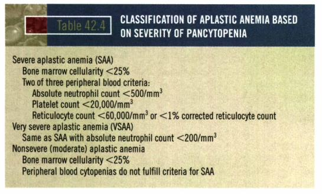
*تصویر 20*

اسلایدِ طبقه‌بندی بر پایهٔ شدت چنین می‌گوید:

- **Severe aplastic anemia (SAA):** cellularity کمتر از ۲۵٪ و دست‌کم دو مورد از سه معیار خون محیطی:
  - absolute neutrophil count کمتر از ۵۰۰/mm³؛
  - platelet کمتر از ۲۰٬۰۰۰/mm³؛
  - reticulocyte کمتر از ۶۰٬۰۰۰/mm³ یا corrected reticulocyte count کمتر از ۱٪.
- **Very severe aplastic anemia (VSAA):** همان معیارهای SAA، با absolute neutrophil count کمتر از ۲۰۰/mm³.
- **Nonsevere (moderate) aplastic anemia:** cellularity کمتر از ۲۵٪ و cytopeniaهای خون محیطی که معیارهای SAA را کامل نمی‌کنند.

همچنین، جدول طبقه‌بندی، با عنوان «دو مورد از سه معیار باید برقرار باشد»، برای nSAA/MAA، SAA و VSAA این مقادیر را نشان می‌دهد:

| شاخص | nSAA/MAA | SAA | VSAA |
|---|---:|---:|---:|
| Neutrophils | کمتر از ۱٫۰ G/L | کمتر از ۰٫۵ G/L | کمتر از ۰٫۲ G/L |
| Platelet | کمتر از ۵۰ G/L | کمتر از ۲۰ G/L | کمتر از ۲۰ G/L |
| Reticulocytes | کمتر از ۲۰ G/L | کمتر از ۲۰ G/L | کمتر از ۲۰ G/L |

نسخهٔ دیگری از همان جدول، neutrophils را به‌ترتیب کمتر از ۱٫۵، ۰٫۵ و ۰٫۲ نشان می‌دهد و برای platelet مقادیر کمتر از ۵۰، ۲۰ و ۲۰ و برای reticulocyte مقادیر کمتر از ۱۰، ۱۰ و ۱۰ درج کرده است.

> [BOX:REVIEW]
> **اختلاف مقادیر جدول شدت**
> اسلاید چند نسخه/ردیف از جدول را نشان می‌دهد که برای neutrophils و reticulocytes آستانه‌های متفاوت دارند؛ همهٔ مقادیر خوانا حفظ شده‌اند و نباید بدون بررسی، انتخاب یکی از نسخه‌ها را جایگزین دیگری کرد.
> **وضعیت:** نیازمند بررسی

در بیمار شدید، شمارش سلول‌ها پایین است؛ برآورد درصد cellularity باید با درنظرگرفتن کل میدان به‌عنوان ۱۰۰٪ و میانگین‌گیری از میدان‌های مختلف انجام شود. در بیمارانی که درمان حمایتی دریافت می‌کنند، supportive care باید با احتیاط به‌کار رود.

### تظاهرات بالینی

*تصویر 21*

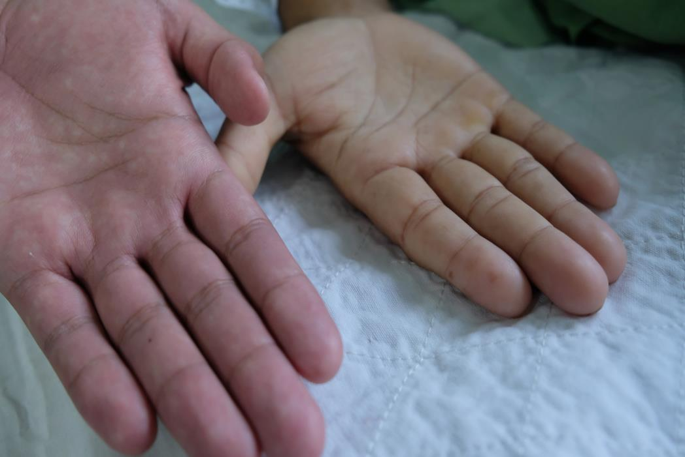
*تصویر 22*

علائم غیراختصاصی شامل موارد زیر است:

- fatigue، dizziness و headache؛
- fever؛
- shortness of breath؛
- ضربان قلب سریع یا نامنظم؛
- pale skin.

با thrombocytopenia بیمار مستعد خون‌ریزی و با neutropenia مستعد عفونت می‌شود. ممکن است bruising آسان یا بدون علت، petechiae، nosebleeds، خون‌ریزی لثه و طولانی‌شدن خون‌ریزی زخم دیده شود. در شرح اسلاید، petechiae به‌عنوان علامت برجسته ذکر شده است.

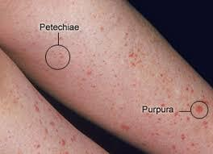
*تصویر 23*

تصاویر با برچسب Petechiae و Purpura آمده‌اند. خون‌ریزی ناشی از کاهش platelet معمولاً پوستی و مخاطی است:

- **petechiae:** نقاط خون‌ریزی حدود ۲–۳ میلی‌متری؛
- **purpura:** از نظر ظاهر مشابه petechiae، ولی حدود ۳–۵ میلی‌متر؛
- **ecchymosis:** کبودی گسترده‌تر؛ این اصطلاح برای کبودی به‌کار می‌رود؛
- **hematoma:** خون پس از آسیب رگ در زیر بافت جمع می‌شود و پوست را بالا می‌آورد.

> [BOX:DEFINITION]
> **petechiae، purpura، ecchymosis و hematoma**
> Petechiae نقاط خون‌ریزی حدود ۲–۳ میلی‌متری‌اند؛ purpura از نظر ظاهر مشابه petechiae، ولی حدود ۳–۵ میلی‌متر است؛ ecchymosis کبودی گسترده‌تر است؛ و hematoma تجمع خون در زیر بافت پس از آسیب رگ است که پوست را بالا می‌آورد.

این ضایعات ممکن است در نقاط مختلف بدن و بیشتر در نواحی پرفشار یا پرتحرک مانند مچ دست، آرنج و مچ پا دیده شوند.

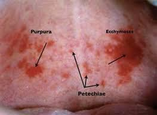
*تصویر 24*

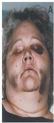
*تصویر 25*

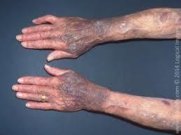
*تصویر 26*

اسلایدهای تصویری بعدی نیز در بخش تظاهرات بالینی قرار دارند.

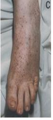
*تصویر 27*

در اسلاید، محل‌های درگیری دهانی، pharyngeal و pulmonary به‌عنوان شایع‌ترین محل‌ها ذکر شده‌اند. در افراد neutropenic، عفونت Candida نیز ممکن است روی زبان و در حفرهٔ دهان دیده شود.

### یافته‌های آزمایشگاهی و مورفولوژی

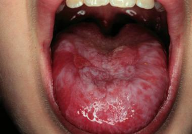
*تصویر 28*

مهم‌ترین یافتهٔ آزمایشگاهی Pancytopenia است. در ابتدا ممکن است فقط یک یا دو شاخص کاهش یافته باشند. اسلاید، در بخش خون محیطی، WBC کمتر از ۲٫۰، Hb کمتر از ۱۰ و platelet کمتر از ۱۰۰ را ذکر می‌کند و می‌گوید gross morphological abnormality وجود ندارد؛ کم‌خونی معمولاً NCNC و همراه با reticulocytopenia است. در همان اسلاید آمده است که Ham’s test در ۱۰٪ مثبت است و لیز وابسته به complement را نشان می‌دهد.

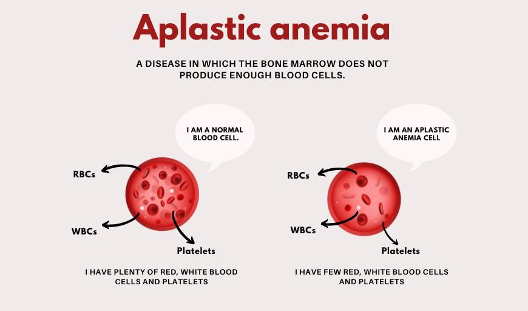
*تصویر 29*

تصویر مقایسه‌ای، تولید normal RBC، WBC و platelets در وضعیت طبیعی را با کاهش هر سه در aplastic anemia نشان می‌دهد؛ در AA مغز استخوان به‌اندازهٔ کافی سلول خونی تولید نمی‌کند.

کم‌خونی خون محیطی معمولاً normocytic normochromic (NCNC) است، هرچند گاهی macrocytic می‌شود. یک توضیح مطرح‌شده این است که بافت به‌دلیل کم‌خونی به اکسیژن نیاز دارد و سنسورهای اکسیژن کلیه EPO را افزایش می‌دهند؛ با وجود EPO زیاد، marrow پاسخ مؤثر نمی‌دهد و سلول‌های تولیدشده ممکن است کمی macrocytic باشند. در مثال آموزشی megaloblastic anemia، MCV حدود ۱۰۰–۱۱۰ را macrocytic و بالاتر از آن را megaloblastic توصیف کردند.

> [BOX:EXAMPLE]
> در مثال آموزشی megaloblastic anemia، MCV حدود ۱۰۰–۱۱۰ را macrocytic و بالاتر از آن را megaloblastic توصیف کردند.

در peripheral blood ممکن است anisocytosis و poikilocytosis، به‌ویژه oval macrocytes، دیده شود. Macrocytosis گاهی در پاسخ به سطوح بالای EPO برجسته است؛ leukopenia و thrombocytopenia نیز وجود دارند. یافته‌های erythrokinetic عبارت‌اند از:

- serum iron بالا؛
- کاهش plasma iron turnover؛
- کاهش total و effective erythropoiesis.

اسلاید، marrow aspirate را متشکل از RBCها، lymphocytes، تعدادی plasma cell و mast cell و ذرات چربی توصیف می‌کند و افزایش storage iron را ذکر می‌کند.

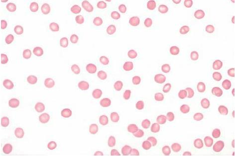
*تصویر 45*

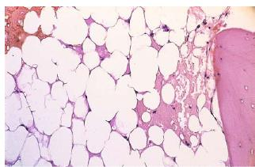
*تصویر 46*

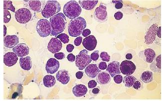
*تصویر 47*

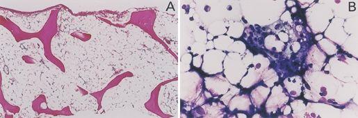
*تصویر 48*

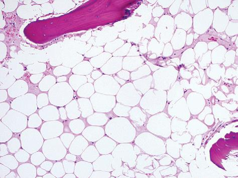
*تصویر 49*

در یک تصویر، section از hypocellular marrow در aplastic anemia با cellularity کمتر از ۵٪ نشان داده شده است.

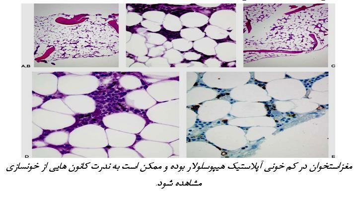
*تصویر 50*

در اسلایدهای آزمایشگاهی دیگر، serum iron افزایش‌یافته، folate و cobalamin (B9, B12) طبیعی، معمولاً hypogammaglobulinemia و HLA-DR2 ذکر شده‌اند.

در marrow شدیداً hypocellular، فاصلهٔ RBCها زیاد و marrow پر از چربی است؛ نمای حاصل honeycomb نامیده می‌شود. ممکن است lymphocyte و plasma cell دیده شوند. برجسته‌بودن lymphocyteها لزوماً به معنای افزایش واقعی آن‌ها نیست و می‌تواند ناشی از کم‌شدن رده‌های دیگر باشد (partial lymphocytosis). در نمای دیگری، cellularity حدود ۵٪ است و trabeculaهای استخوانی و اندکی سلول خون‌ساز دیده می‌شوند. وقتی fibrosis مطرح است، رشته‌های collagen فضاهای خون‌ساز را اشغال کرده‌اند.

Erythropoietin در خون این بیماران افزایش می‌یابد؛ آهن نیز در خون باقی می‌ماند و کمتر وارد marrow می‌شود. در بررسی‌های قدیمی iron turnover، آهن نشاندار با کربن ۱۴ یا مادهٔ radioactive و گاهی chromium به بیمار داده می‌شد و نمونه‌های متوالی، از جمله پس از دو ساعت و ۲۴ ساعت، بررسی می‌شدند. Turnover پایین نشان می‌داد که آهن در خون می‌ماند و برای تولید RBC وارد marrow نمی‌شود.

> [BOX:EXAMPLE]
> در بررسی‌های قدیمی iron turnover، آهن نشاندار با کربن ۱۴ یا مادهٔ radioactive و گاهی chromium به بیمار داده می‌شد و نمونه‌های متوالی، از جمله پس از دو ساعت و ۲۴ ساعت، بررسی می‌شدند؛ turnover پایین نشان می‌داد که آهن در خون می‌ماند و برای تولید RBC وارد marrow نمی‌شود.

### پاتوفیزیولوژی

*تصویر 30*

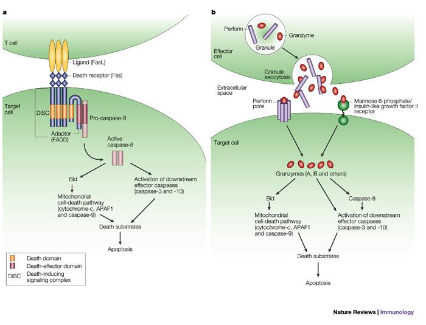
*تصویر 31*

اسلاید چهار دستهٔ احتمالی برای AA را مطرح می‌کند:

- immunosuppressive/immune-mediated؛
- stem cell غیرطبیعی یا ناکافی؛
- نقص bone marrow matrix؛
- کمبود growth factor.

توضیح اصلی دربارهٔ acquired AA این است که بیماری معمولاً به‌صورت immune-mediated توصیف می‌شود، هرچند علت آغازگر ممکن است idiopathic باشد. سلول‌های ایمنی به hematopoietic stem cellها و progenitorهای مغز استخوان حمله می‌کنند. این سلول‌ها قدرت تقسیم زیادی دارند و ممکن است بیش از ۱۰۰ بار mitosis انجام دهند؛ مرگ زودرس stem cellها و progenitorهای اولیه باعث کاهش تدریجی جمعیت سلولی و درگیری هر سه رده می‌شود.

از شواهد سازوکار ایمنی، افزایش CD8 (cytotoxic lymphocyte) و افزایش TNF-α و IFN-γ است. در HSC، Fas بیان می‌شود و مسیر مرگ سلولی فعال می‌گردد؛ سلول‌های cytotoxic می‌توانند به progenitorهای Fas-expressing حمله کنند. اسلاید به افزایش CD8، بیان Fas روی HSC و افزایش TNF-α و IFN-γ اشاره می‌کند.

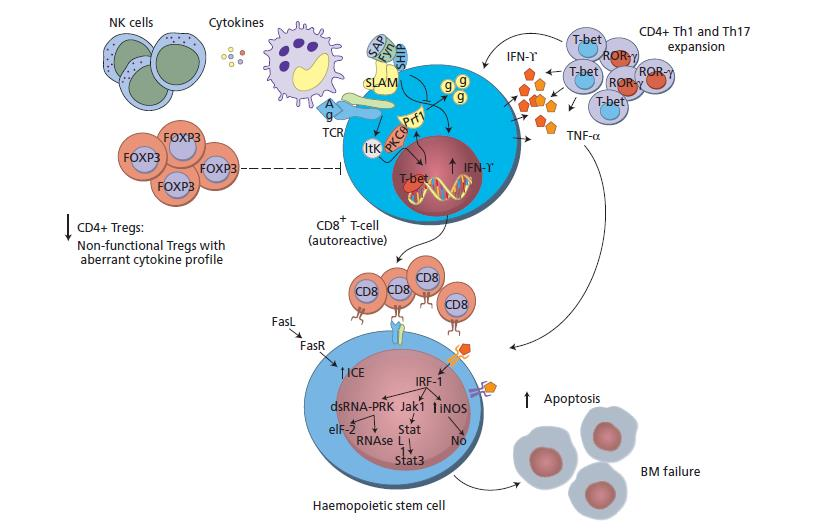
*تصویر 32*

نمودار اسلاید، expansion سلول‌های CD4+ Th1، سلول‌های CD4+ Treg ناکارآمد با cytokine profile غیرطبیعی و autoreactive، apoptosis و در نهایت BM failure در hematopoietic stem cell را نشان می‌دهد.

حتی اگر progenitor cell سالم باشد و Fas بیان نکند، microenvironment نامناسب نیز می‌تواند خون‌سازی را مختل کند؛ همان‌طور که دانه در خاک نامناسب رشد نمی‌کند. اختلال در bone marrow matrix یا stroma ممکن است سبب اختلال در پاسخ به BMT شود. اسلاید برای این مورد، defect در microenvironment و عدم پاسخ به BMT را مطرح می‌کند. همچنین، نقص در تحریک hormonal stem cell growth factor به‌عنوان عامل احتمالی کمبود growth factor ذکر شده است.

در برخی بیماران، antibody بر ضد kinectin و diazepam-binding protein (Acyl Co-A receptor) گزارش شده است. kinectin روی سطح سلول مطرح است؛ diazepam-binding protein در cell motility و ارتباط با intracellular ER system و mitochondria و نیز integrin attachment نقش داده شده است. اسلاید درمان‌های immune-mediated را نیز با anti-thymocyte globulin (ATG)، anti-lymphocyte globulin (ALG) و Cyclosporine A مرتبط می‌کند.

### علت‌ها و دسته‌بندی acquired AA

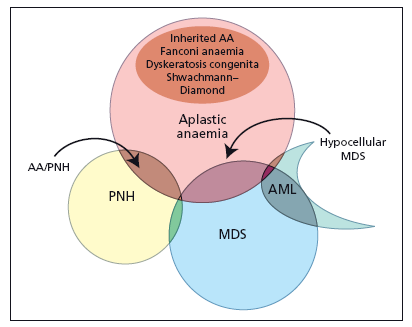
*تصویر 33*

Aplastic anemia می‌تواند acquired یا constitutional/inherited باشد؛ Fanconi anemia از نمونه‌های constitutional است. اسلایدها حدود ۶۰٪ موارد را idiopathic معرفی می‌کنند و idiopathic factors را شایع‌ترین گروه می‌دانند. در توضیح گفتاری گفته شد حدود ۷۰–۷۵٪ موارد acquired، idiopathic هستند و بقیه به عامل قابل‌شناسایی‌تری وابسته‌اند. Idiopathic یعنی علت اولیه را نمی‌دانیم، هرچند عوامل متعددی شناخته شده‌اند.

> [BOX:DEFINITION]
> **Idiopathic**
> یعنی علت اولیه را نمی‌دانیم، هرچند عوامل متعددی شناخته شده‌اند.

> [BOX:REVIEW]
> **فراوانی موارد idiopathic**
> اسلاید حدود ۶۰٪ و گفتار حدود ۷۰–۷۵٪ از موارد acquired را idiopathic می‌داند؛ هر دو برآورد حفظ شده‌اند و مبنای تفاوت روشن نیست.
> **وضعیت:** نیازمند بررسی

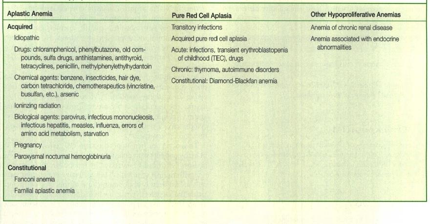
*تصویر 34*

علت‌های acquired شامل radiation، مواد شیمیایی و داروها، viral infectionها و اختلالات ایمنی‌اند. عوامل دیگر عبارت‌اند از pregnancy، thymoma، immunologic disease و transfusional graft-versus-host disease (GVHD). عفونت‌های مرتبط شامل viral hepatitis، HIV، EBV و Parvovirus B19 است. در اسلایدهای علل، PNH نیز کنار این بیماری‌ها آمده است.

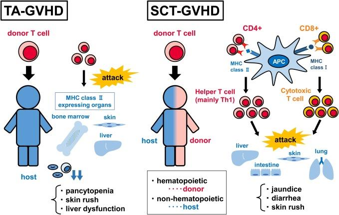
*تصویر 35*

نمودار GVHD، donor T cell و MHC class I/II را نشان می‌دهد: helper T cell، عمدتاً Th1، و cytotoxic T cell در آسیب به بافت‌ها نقش دارند. در GVHD، درگیری bone marrow با pancytopenia، درگیری skin با rash و درگیری liver و intestine با jaundice، liver dysfunction و diarrhea همراه می‌شود؛ host و donor و بافت‌های hematopoietic و non-hematopoietic نیز در شکل مشخص شده‌اند.

#### مواد شیمیایی و مواجهه‌ها

مواد و مواجهه‌های شیمیایی شامل benzene، mustard، ionizing radiation، بعضی سموم و insecticides و antineoplastic/antimetaboliteها هستند.

در شرح شفاهی از تجربهٔ تماس با benzene در تولید کفش در چین در سال ۲۰۰۶ گفته شد: موارد AA در نوجوانان شاغل در کارگاه‌های کفش‌سازی افزایش یافته بود و چسب حاوی benzene برای حل‌کردن رزین به‌کار می‌رفت. پس از کنارگذاشتن benzene و جایگزینی ترکیبات الکلی، موارد گزارش‌شده کاملاً برگشتند.

> [BOX:EXAMPLE]
> در تجربهٔ تماس با benzene در تولید کفش در چین در سال ۲۰۰۶، موارد AA در نوجوانان شاغل در کارگاه‌های کفش‌سازی افزایش یافته بود و چسب حاوی benzene برای حل‌کردن رزین به‌کار می‌رفت. پس از کنارگذاشتن benzene و جایگزینی ترکیبات الکلی، موارد گزارش‌شده کاملاً برگشتند.

Mustard یا گاز خردل نیز ممکن است آسیب پایدار ایجاد کند. در تجربه‌ای که در درس مطرح شد، کودکانی در مرکز oncology اطفال بیمارستان علی‌اصغر تهران دیده شده بودند که خانواده‌هایشان از کردستان ایران یا عراق آمده بودند. در برخی موارد، پدر یک نسل پیش‌تر در معرض mustard قرار گرفته بود و نسل بعد با leukemia مراجعه می‌کرد. این مثال برای نشان‌دادن امکان آسیب پایدار مطرح شد.

> [BOX:EXAMPLE]
> در تجربهٔ مطرح‌شده در درس، در برخی خانواده‌ها پدر یک نسل پیش‌تر در معرض mustard قرار گرفته بود و نسل بعد با leukemia مراجعه می‌کرد؛ این مثال برای نشان‌دادن امکان آسیب پایدار مطرح شد.

Methotrexate که برای برخی بیماری‌های خودایمنی، از جمله rheumatoid arthritis یا درجاتی از lupus تجویز می‌شود، antimetabolite و آنتاگونیست ویتامین B9 معرفی شد و می‌تواند با آسیب به marrow مطرح باشد. تماس شغلی با سم و pesticide، از جمله در کشاورزی و در نبود تجهیزات حفاظتی، و نیز رنگ مو و مواد دکلرهٔ ترکیب‌شده با oxidantها در اسلاید/گفتار مطرح شدند. همچنین، در تجربهٔ شفاهی، مواردی از AA پس از قطرهٔ چشمی Chloramphenicol با غلظت ۰٫۲۵٪ ذکر شد.

> [BOX:EXAMPLE]
> در تجربهٔ شفاهی، مواردی از AA پس از قطرهٔ چشمی Chloramphenicol با غلظت ۰٫۲۵٪ ذکر شد.

#### داروهای مرتبط با aplastic anemia

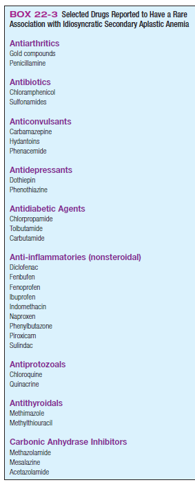
*تصویر 36*

اسلاید «Selected Drugs Reported to Have a Rare Association with Idiosyncratic Secondary Aplastic Anemia» داروهای زیر را فهرست می‌کند:

- **Antiarthritics:** gold compounds، penicillamine.
- **Antibiotics:** chloramphenicol، sulfonamides.
- **Anticonvulsants:** carbamazepine، hydantoins، phenacemide.
- **Antidepressants:** dothiepin، phenothiazine.
- **Antidiabetic agents:** chlorpropamide، tolbutamide، carbutamide.
- **Nonsteroidal anti-inflammatories:** diclofenac، fenbufen، fenoprofen، ibuprofen، indomethacin، naproxen، phenylbutazone، piroxicam، sulindac.
- **Antiprotozoals:** chloroquine، quinacrine.
- **Antithyroidals:** methimazole، methyithiouracil.
- **Carbonic anhydrase inhibitors:** methazolamide، mesalazine، acetazolamide.

اسلاید دیگری از همان جعبهٔ دارویی نیز این گروه‌ها را تکرار می‌کند؛ اختلافات OCR در املای بعضی نام‌ها، از جمله penicillamine، quinacrine و methimazole، به‌صورت املای قابل‌شناسایی بالا یکدست شده است.

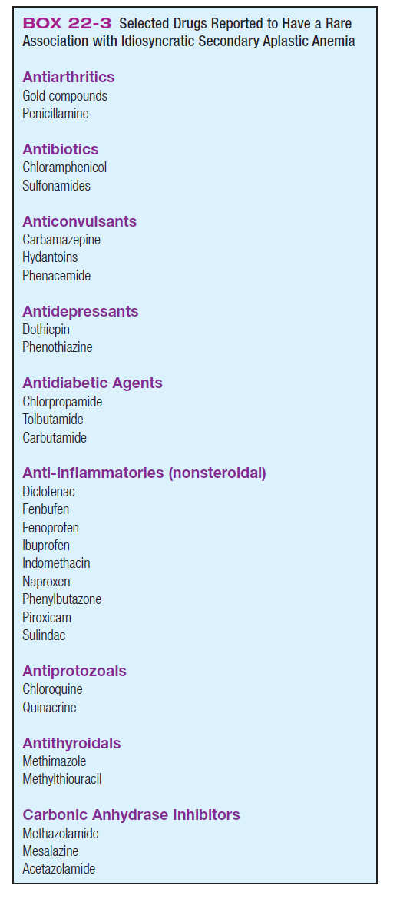
*تصویر 39*

در اسلاید «Classification of drugs most commonly implicated»، گروه‌ها و نمونه‌های زیر آمده‌اند:

- **Nonsteroidal analgesics:** phenylbutazone، indomethacin، ibuprofen، sulindac، diclofenac و piroxicam.
- **Anticonvulsants:** hydantoins، carbamazepine و phenacemide.
- **Antibiotics:** sulfonamides و chloramphenicol.
- **Antiprotozoals:** quinacrine و chloroquine.
- **Antithyroid drugs:** methimazole و propylthiouracil.
- **Gold.**

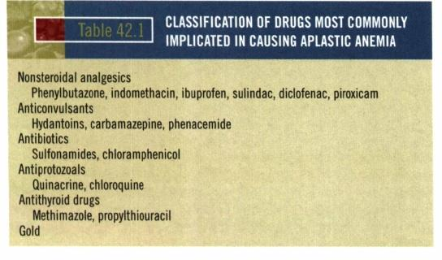
*تصویر 40*

در تکرار جدول روی اسلاید، antidepressants (dothiepin، phenothiazine)، antidiabetic agents (chlorpropamide، tolbutamide، carbutamide)، anti-inflammatories، antiprotozoals، antithyroidals (methimazole، methylthiouracil) و carbonic anhydrase inhibitors (methazolamide، mesalazine، acetazolamide) نیز درج شده‌اند.

Idiosyncratic یا idiosyncrasy با idiopathic تفاوت دارد: idiopathic یعنی علت نامشخص است؛ idiosyncratic یعنی فرد زمینه یا استعداد ذاتی دارد و با یک inducer یا محرک ممکن است بیماری بروز کند.

> [BOX:DEFINITION]
> **Idiosyncratic یا idiosyncrasy**
> یعنی فرد زمینه یا استعداد ذاتی دارد و با یک inducer یا محرک ممکن است بیماری بروز کند؛ این اصطلاح با idiopathic، یعنی نامشخص‌بودن علت، تفاوت دارد.

اسلاید hypersensitive aplastic anemia، داروهای متعدد و dose-independent/idiosyncratic بودن برخی واکنش‌ها را یادآوری می‌کند:

- **Antibiotics:** chloramphenicol، salvarsan، sulfonamides، chlortetracycline و streptomycin.
- **Anticonvulsants:** mephenytoin و trimethadione.
- **Analgesic:** phenylbutazone.
- **Antithyroid drug:** carbimazole.
- **Antihistaminic:** tripelennamine.
- **H2-histamine receptor antagonist:** cimetidine.
- **Insecticides:** dichlorophenyltrichloroethane (DDT).
- **مواد دیگر:** gold compounds، quinacrine، chlorpromazine، hair dyes، bismuth و mercury.

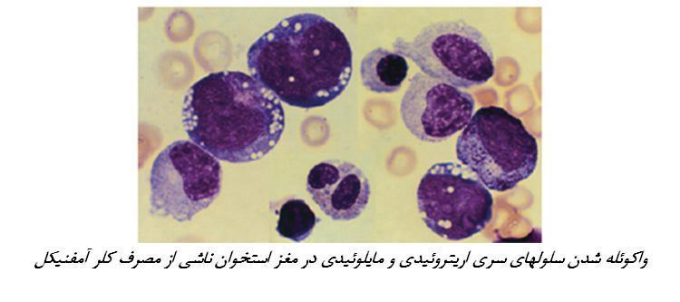
*تصویر 41*

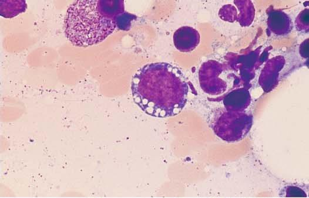
*تصویر 42*

در تصویر مربوط به Chloramphenicol، vacuolation در سلول‌های erythroid و myeloid marrow ذکر شده است. توضیح شفاهی، نمونه‌هایی از pronormoblastهای بزرگ و پر از vacuole را، به‌ویژه در درگیری با Chloramphenicol، نشان می‌دهد.

> [BOX:EXAMPLE]
> در تصویر مربوط به Chloramphenicol، vacuolation در سلول‌های erythroid و myeloid marrow و در توضیح شفاهی pronormoblastهای بزرگ و پر از vacuole نشان داده شده‌اند.

#### اثر radiation

Radiation نیز ممکن است به AA منجر شود.

*تصویر 37*

در ترتیب حساسیت رده‌ها، erythroid precursorها از همه حساس‌ترند، پس از آن granulocyte و سپس megakaryocyte قرار دارند؛ stromal cellها نسبتاً مقاوم‌اند.

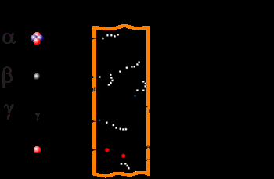
*تصویر 38*

پس از acute radiation، reticulocyte count کاهش می‌یابد، درحالی‌که RBCها آهسته‌تر افت می‌کنند. در چند ساعت اول ممکن است neutrophilic leukocytosis ناشی از جابه‌جایی از marginal و احتمالاً marrow storage pool رخ دهد. پس از روز اول، lymphocyteها کاهش می‌یابند و early leukopenia ایجاد می‌شود؛ پس از حدود پنج روز، granulocyteها شروع به افت می‌کنند. Plateletها دیرتر کاهش می‌یابند و در بهبودی نیز اغلب آخرین رده‌ای هستند که به مقدار طبیعی برمی‌گردند.

Quiescent marrow stem cellها در برابر یک دوز منفرد irradiation به‌طور چشمگیری مقاوم توصیف شده‌اند، اما مواجههٔ مزمن با دوز پایین، از جمله radiation موضعی، با افزایش تأخیری خطر AA به‌دلیل اثر بر stem cell replicating pool مرتبط است. در توضیح شفاهی، حساسیت stem cell مادر نیز تأکید شد و بیان شد که RBC بالغ در برابر تشعشع مقاوم است. برای اطمینان از حذف lymphocyteهای کیسهٔ خون، در شیراز حدود ۶۰–۷۰ واحد خون را irradiate می‌کنند؛ این مثال برای تمایز RBC بالغ مقاوم از erythroid precursor حساس مطرح شد.

> [BOX:EXAMPLE]
> برای اطمینان از حذف lymphocyteهای کیسهٔ خون، در شیراز حدود ۶۰–۷۰ واحد خون را irradiate می‌کنند؛ این مثال برای تمایز RBC بالغ مقاوم از erythroid precursor حساس مطرح شد.

#### تشخیص افتراقی و prognosis

*تصویر 43*

AA باید از موارد زیر افتراق داده شود:

- acute leukemia؛
- myelodysplastic syndrome (MDS)؛
- myelofibrosis؛
- bone marrow tuberculosis؛
- PNH.

در Pancytopenia باید bone marrow بررسی شود: در AA cellularity پایین است، درحالی‌که در leukemia معمولاً بسیار بالا می‌شود. MDS نوعی بیماری خونی در گروه بدخیمی‌هاست که گاهی pre-leukemia نامیده می‌شود؛ سلول‌ها تولید می‌شوند، اما dysplastic و بدشکل‌اند و شکل طبیعی hematopoiesis را ندارند. در myelofibrosis، Reticulin و collagen افزایش می‌یابند و فضای خون‌ساز را اشغال می‌کنند؛ fibrosis در biopsy دیده می‌شود. حالت‌های شدید megaloblastic anemia نیز ممکن است با چنین نمایی همراه باشند.

در اسلاید افتراق‌ها، برای موارد زیر بررسی‌های مشخصی پیشنهاد شده است:

- **Aplastic anemia در برابر myelodysplasia:** بررسی pseudo-Pelger-Huet cells، hypogranulated neutrophils و dysplasia در marrow.
- **Aplastic anemia در برابر aleukemic leukemia:** chromosome analysis برای breaks، duplications و rearrangements؛ همچنین FACS خون محیطی برای white cells دارای leukemia markers و جست‌وجوی blast cell در marrow.
- **افتراق از myelofibrosis:** بررسی خون محیطی از نظر misshapen RBCها و marrow از نظر fibrosis.
- **افتراق از bone marrow tuberculosis:** بررسی PPD (tuberculosis skin test)، رنگ‌آمیزی marrow برای acid-fast bacteria و marrow culture برای mycobacteria.
- **افتراق از PNH:** Ham test برای red cell lysis که در PNH مثبت است و FACS برای GPI-linked membrane proteins که در PNH کاهش‌یافته یا غایب‌اند.

Anemia، thrombocytopenia و neutropenia به‌عنوان manifestation مشترک فهرست‌شده برای این افتراق‌ها آمده‌اند.

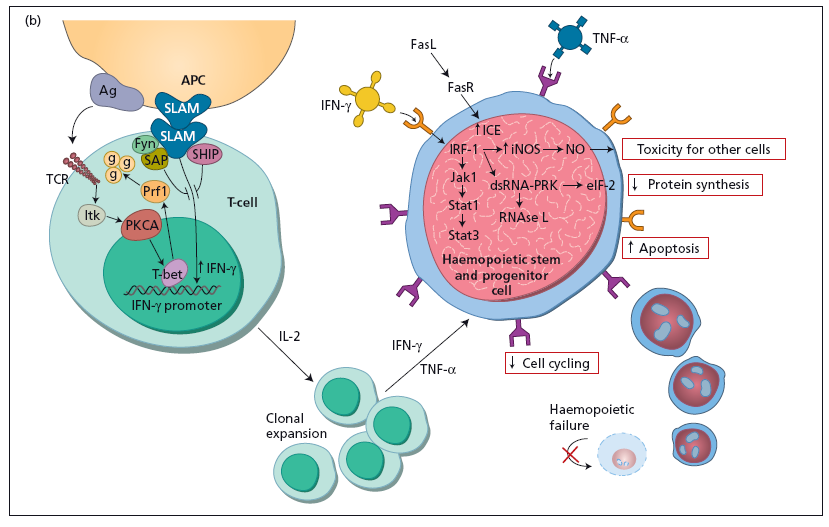
*تصویر 44*

AA می‌تواند با PNH overlap داشته باشد؛ برخی بیماران AA ممکن است به PNH برسند و برخی بیماران PNH به AA. تشخیص افتراقی یا overlap با MDS نیز مطرح است و ممکن است در روند بیماری، درمان یا حتی پس از BMT شواهدی از AA دیده شود.

از نظر prognosis، شدت آسیب marrow، initial blood count و پاسخ به درمان طی چند ماه نخست اهمیت دارند؛ اسلاید male gender را نیز از عوامل prognosis ذکر می‌کند. در گفتار، prognosis در مردان بدتر از زنان دانسته شد و تأکید شد که با گذار از mild/moderate به severe و very severe، prognosis بدتر می‌شود و پاسخ به درمان وضعیت را بهتر می‌کند.

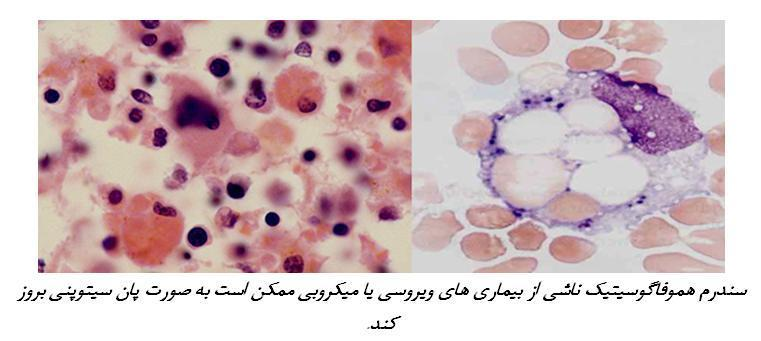
*تصویر 51*

یکی از متن‌های تصویری، hemophagocytic syndrome ناشی از بیماری‌های ویروسی را با بروز به‌شکل Pancytopenia مطرح می‌کند.

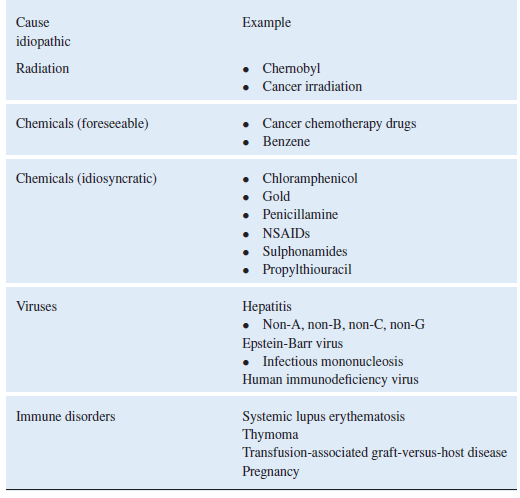
*تصویر 52*

جدول علل، دسته‌ها و نمونه‌های زیر را کنار هم آورده است:

- **Radiation:** مثلاً Chernobyl و irradiation برای cancer.
- **مواد شیمیایی:** benzene و mustard.
- **داروهای chemotherapy و idiosyncratic:** chloramphenicol، gold، penicillamine، NSAIDs، sulphonamides و propylthiouracil.
- **ویروس‌ها:** hepatitis، Epstein-Barr virus/infectious mononucleosis و human immunodeficiency virus.
- **اختلالات ایمنی:** systemic lupus erythematosus، thymoma و transfusion-associated GVHD.
- **سایر موارد:** pregnancy و idiopathic.

#### درمان

درمان‌های مطرح‌شده عبارت‌اند از:

- anti-thymocyte globulin (ATG)؛
- anti-lymphocyte globulin (ALG)؛
- cyclosporine؛
- androgen؛
- cyclophosphamide؛
- alemtuzumab (anti-CD52)؛
- eltrombopag؛
- bone marrow transplant (BMT).

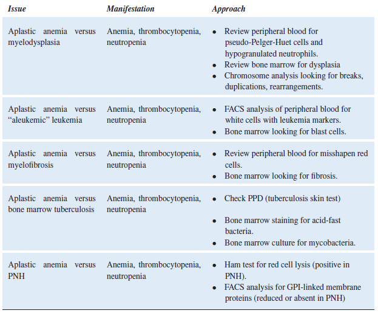
*تصویر 53*

شکل درمانی TPO mimics، اتصال به thrombopoietin receptor، فعال‌شدن receptor و signal transduction، از جمله P42 یا P44، را به افزایش تولید platelet پیوند می‌دهد و Romiplostim و Eltrombopag را نشان می‌دهد. در گفتار، eltrombopag ترکیبی سنتزی شبیه TPO توصیف شد که می‌تواند تولید platelet را تحریک کند، بدون آنکه platelet مستقیماً تزریق شود.

ATG و ALG به‌عنوان درمان‌های immune suppression مطرح‌اند. Cyclosporine نیز در بیماران پیوند عضو برای کاهش rejection و سرکوب سیستم ایمنی استفاده می‌شود و در AA می‌تواند به بهبود کم‌خونی کمک کند. انتقال خون، platelet در صورت تمایل به خون‌ریزی و آنتی‌بیوتیک برای خطر عفونت، درمان حمایتی و علامتی‌اند، نه درمان اصلی بیماری.

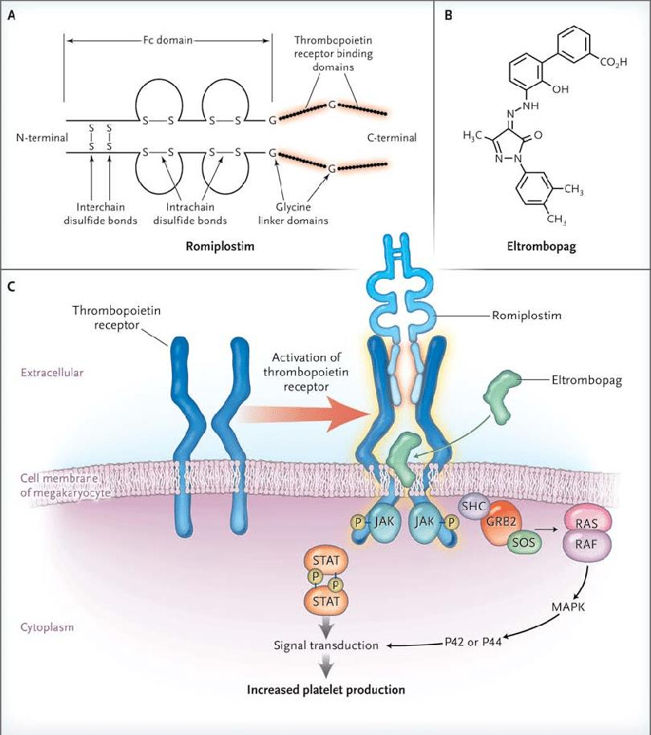
*تصویر 54*

*تصویر 55*

*تصویر 56*

### Inherited bone marrow failure و Fanconi anemia

#### انواع inherited bone marrow failure و Fanconi anemia

*تصویر 57*

حدود ۲۰٪ موارد در اسلاید ذیل inherited آمده‌اند. نمونه‌های نام‌برده عبارت‌اند از Fanconi anemia، Dyskeratosis congenita و Shwachman-Diamond syndrome.

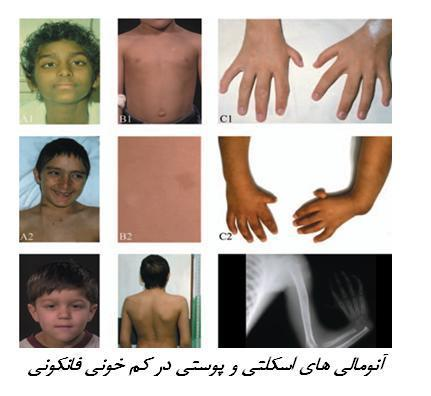
*تصویر 58*

Fanconi anemia (FA) شایع‌ترین علت hereditary bone marrow failure معرفی شده است. اسلاید آن را به‌جز نوع B، autosomal recessive ذکر می‌کند. Pancytopenia معمولاً پس از infancy آشکار می‌شود و تا حدود ۸سالگی به‌طور معمول قابل‌توجه است. کم‌خونی normochromic و گاهی macrocytic است؛ Hb F و i antigen ممکن است افزایش یابند و marrow عموماً hypocellular باشد.

در توضیح شفاهی، Hb F که در نوزاد ممکن است ۶۵–۹۰٪ باشد و تا بزرگسالی به کمتر از ۱٪ برسد، در Fanconi anemia بالا باقی می‌ماند. همچنین در سیستم گروه خونی Ii، i کوچک نوزاد معمولاً طی حدود ۲–۳سالگی به I بزرگ switch می‌کند، اما در Fanconi anemia ممکن است i باقی بماند.

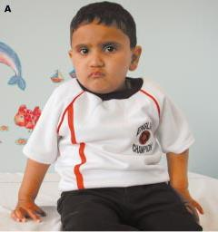
*تصویر 59*

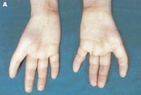
*تصویر 60*

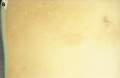
*تصویر 61*

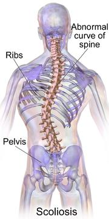
*تصویر 62*

*تصویر 63*

> [BOX:EXAMPLE]
> در Fanconi anemia، Hb F ممکن است بالا باقی بماند و i ممکن است پس از زمانی که معمولاً به I بزرگ switch می‌کند، همچنان باقی بماند.

#### تظاهرات بالینی FA

بیماران FA ممکن است ناهنجاری‌های اسکلتی و پوستی داشته باشند:

- شکل غیرطبیعی انگشت شست و اندام‌ها؛
- bifid hand؛
- لکه‌های پوستی یا Café au lait؛
- تیره‌شدن پوست؛
- فرورفتگی پل بینی با عنوان saddle nose؛
- scoliosis.

در یک نمونهٔ بالینی، کودک به‌دلیل پیچ‌خوردگی ستون مهره‌ها نمی‌توانست صاف بنشیند. در scoliosis، ستون فقرات به طرفین منحرف است؛ lordosis به قوس رو به جلو و برجستگی شکم و kyphosis به قوس رو به عقب یا قوز اشاره دارد. اسلایدهای تصویری نیز ناهنجاری‌های پوست و اسکلت، Café au lait و scoliosis را نشان می‌دهند.

> [BOX:EXAMPLE]
> در یک نمونهٔ بالینی، کودک به‌دلیل پیچ‌خوردگی ستون مهره‌ها نمی‌توانست صاف بنشیند.

#### ژن‌ها و زیرگروه‌های FA

*تصویر 64*

جدول FA genes/proteins، از جمله FANCA، FANCB، FANCC، FANCD1/BRCA2، FANCD2، FANCE، FANCF، FANCG، FANCI/BRIP1، FANCL، FANCM و FANCN/PALB2 را با chromosomal locus، exons، frequency یا protein size فهرست می‌کند؛ تعدادی از حروف و اعداد جدول در متن قابل‌خواندن نیستند.

> [BOX:REVIEW]
> **جزئیات جدول ژن‌های FA**
> بخشی از مختصات کروموزومی، تعداد exonها و اندازهٔ protein در OCR ناخواناست؛ نام‌های قابل‌تشخیص حفظ شده‌اند و مقادیر ناخوانا بازسازی نشده‌اند.
> **وضعیت:** نیازمند بررسی

در گفتار، تعداد ژن‌های شناخته‌شده از حدود ۱۳ به ۲۱ ژن بیان شد. تقریباً همهٔ ژن‌های FA روی autosome هستند، به‌جز FANCB که روی X قرار دارد. FANCD1 همان BRCA2 است؛ اشاره به BRCA2 برای توضیح ارتباط این ژن با breast cancer بود و به این معنا نیست که بیماران FA الزاماً breast cancer می‌گیرند؛ خطر cancer در این بیماران افزایش می‌یابد.

حدود ۶۵٪ جهش‌های Fanconi در گفتار به FANCA نسبت داده شد و توصیه شد در بررسی اولیه این ژن در نظر گرفته شود. اسلاید می‌گوید Group A (FANCA) تقریباً در ۷۰٪ بیماران FA رخ می‌دهد و با خطر بیشتر leukemia و تومورهای non-hematologic، به‌ویژه head and neck، liver، lower esophagus و vulva، همراه است. تفاوت درصدهای ۶۵٪ و حدود ۷۰٪ در دو بیان حفظ می‌شود، زیرا یکی برای جهش‌های FANCA و دیگری برای گروه A بیان شده است.

#### بررسی ژنتیکی و ترمیم DNA

*تصویر 65*

تست clastogen، از جمله DEB test، برای بررسی FA به‌کار می‌رود. اسلاید به chromosomal defects در cultured cells پس از مواجهه با Mitomycin C و Diepoxybutane (DEB) اشاره می‌کند؛ چندین FA protein در nuclear complex مربوط به DNA repair شرکت می‌کنند.

*تصویر 66*

جدول زیرگروه‌ها، chromosome location، inheritance pattern، برآورد فراوانی بیماران و وضعیت ubiquitinated FANCD2 را نشان می‌دهد. نام‌های قابل‌تشخیص شامل FANCD1/BRCA2، FANCD2، FANCE، FANCF، FANCG، FANCI، FANCJ/BACH1/BRIP1، FANCL/PHF9/POG، FANCM/HeF و FANCN/PALB2 است.

در گفتار، DEB test چنین توضیح داده شد: سلول‌ها را وارد mitosis می‌کنند و با Mitomycin C یا diepoxybutane مواجه می‌سازند. در افراد سالم، chromosomeها می‌شکنند، اما repair می‌شوند؛ درحالی‌که در جهش‌های FA شکست‌ها بیشترند و repair مؤثر رخ نمی‌دهد. WHO توصیه می‌کند در هر فرد زیر ۲۰ سال با کم‌خونی همراه Pancytopenia، تست‌های Fanconi انجام شوند، حتی اگر ظاهر بیمار طبیعی باشد. پسر ۱۱سالهٔ کیس نیز ممکن است FA داشته باشد.

> [BOX:EXAMPLE]
> در فرد زیر ۲۰ سال با کم‌خونی همراه Pancytopenia، توصیهٔ ذکرشده انجام تست‌های Fanconi حتی در صورت طبیعی‌بودن ظاهر بیمار است؛ پسر ۱۱سالهٔ کیس نیز ممکن است FA داشته باشد.

*تصویر 67*

نمودار DNA damage نشان می‌دهد که DNA damage ناشی از cross-linking agents مانند MMC، FA protein complex را فعال می‌کند و به monoubiquitinationِ FANCD2 می‌انجامد. FANCD2 با BRCA1 تعامل می‌کند تا DNA repair انجام شود. DNA damage ناشی از ionising radiation، ATM را فعال می‌کند؛ ATM علاوه بر FANCD2 چندین protein دیگر را phosphorylate می‌کند تا پاسخ S-phase checkpoint هماهنگ شود.

درمان FA حمایتی است و شامل transfusion و G-CSF/GM-CSF می‌شود؛ درمان curative، BMT است و gene therapy در اسلاید با علامت سؤال آمده است. حدود یک‌سوم بیماران به MDS یا AML می‌رسند و prone به solid tumor هستند.

#### دیگر اختلالات inherited

##### Dyskeratosis congenita

Dyskeratosis congenita با reticulated hyperpigmentation پوست، dystrophic nails و mucous membrane leukoplakia مشخص می‌شود؛ اسلاید X-linked form را DKC1 ذکر می‌کند. در گفتار، ضایعات پوستی گسترده و اختلال ناخن‌ها توصیف شدند. ضایعات مخاطی ممکن است شبیه thrush، قارچ یا aphthae باشند، اما در biopsy، Candida نیستند و leukoplakia محسوب می‌شوند؛ leukoplakia ممکن است روی زبان یا buccal mucosa باشد.

> [BOX:DEFINITION]
> **Dyskeratosis congenita**
> با reticulated hyperpigmentation پوست، dystrophic nails و mucous membrane leukoplakia مشخص می‌شود؛ اسلاید X-linked form را DKC1 ذکر می‌کند.

*تصویر 68*

تصاویر بعدی در ادامهٔ مبحث ناهنجاری‌های inherited قرار دارند.

*تصویر 69*

*تصویر 70*

*تصویر 71*

##### Shwachman-Diamond syndrome و TAR syndrome

Shwachman-Diamond syndrome با exocrine pancreatic insufficiency و neutropenia همراه است؛ اسلاید به SDBS gene و نقش آن در ribosome metabolism و spindle stability اشاره می‌کند.

TAR syndrome، یعنی thrombocytopenia with absent radii، نیز از اختلالات inherited است. گفتار به ارتباط megakaryopoiesis با ساختار اسکلتی اشاره می‌کند و نبودن radius را در radiology بیماران TAR یادآور می‌شود.

> [BOX:DEFINITION]
> **TAR syndrome**
> یعنی thrombocytopenia with absent radii.

*تصویر 72*

جدول BMF syndromeها موارد زیر را نیز فهرست می‌کند:

- Fanconi anemia؛
- Dyskeratosis congenita؛
- Diamond-Blackfan anemia؛
- Shwachman-Diamond syndrome؛
- amegakaryocytic thrombocytopenia؛
- thrombocytopenia with absent radii syndrome؛
- congenital thrombocytopenia and radius-ulna synostosis؛
- Pearson marrow-pancreas syndrome؛
- موردی با برچسب HOXAT1? که در خود اسلاید نیازمند تأیید ذکر شده است.

جدول، mode of inheritance و chromosomal locus را نیز برای موارد مختلف نشان می‌دهد، اما بخشی از ردیف‌ها و جایگاه‌های کروموزومی در OCR به‌هم‌ریخته است. برای acquired BMF در همان جدول موارد زیر آمده‌اند:

- idiopathic؛
- radiation؛
- drugs and chemicals، شامل regular: cytotoxic و benzene و idiosyncratic: chloramphenicol، NSAIDs، antiepileptics و gold؛
- viruses، شامل Epstein-Barr virus، hepatitis، Parvovirus و HIV؛
- immune diseases؛
- thymoma؛
- pregnancy؛
- PNH.

توضیح شفاهی نیز Shwachman-Diamond syndrome و TAR را به‌عنوان نمونه‌های دیگر inherited مطرح می‌کند.

### افتراق پایانی

Pure red cell aplasia از Aplastic anemia متمایز است: در Aplastic anemia ویژگی مهم کاهش هر سه رده است، اما در pure red cell aplasia فقط ردهٔ قرمز کاهش می‌یابد.

> [BOX:DEFINITION]
> **Pure red cell aplasia**
> با Aplastic anemia تفاوت دارد: در pure red cell aplasia فقط ردهٔ قرمز کاهش می‌یابد، درحالی‌که در Aplastic anemia ویژگی مهم کاهش هر سه رده است.

همچنین، اسلاید پایانی عنوان «Agranulocytosis differ from aplastic anemia» را مطرح می‌کند، بی‌آنکه جزئیات افتراق در محتوای موجود آمده باشد.

> [BOX:REVIEW]
> **پایان ناقص گفتار**
> فایل صوتی در انتها نیمه‌کاره قطع می‌شود و جملهٔ بعدی دربارهٔ «کیس‌های آخری» کامل نیست.
> **وضعیت:** نیازمند بررسی

## ۳. جداول مرور سریع

### الگوهای کاهش رده‌های خونی

| وضعیت | رده‌های کاهش‌یافته | ارتباط با Aplastic anemia |
|---|---|---|
| Pancytopenia | WBC، RBC و platelets | یافتهٔ مشخص بیماری؛ هر سه رده و تولید آن‌ها تحت‌تأثیر قرار می‌گیرند. |
| Bicytopenia | دو رده از رده‌های خونی | ممکن است در ابتدای ارزیابی دیده شود و در صورت هم‌خوانی با سایر یافته‌ها باید در نظر گرفته شود. |

### Aspiration در برابر biopsy

| ویژگی | Aspiration | Biopsy |
|---|---|---|
| سوزن | معمولاً کوتاه‌تر | معمولاً بلندتر |
| نمونه | حدود ۱ تا ۱٫۵ سی‌سی مایع marrow | حدود یک سانتی‌متر از نمونهٔ marrow |
| ارزیابی/آماده‌سازی | bone marrow smear؛ باقی نمونه به لولهٔ هپارین و EDTA برای مطالعات cytogenetic، کروموزومی و flow cytometry | touch smear و آماده‌سازی نمونه برای برش‌های پاتولوژی پس از حل‌شدن استخوان، fixation و پارافین |
| ترتیب | در برخی guidelineها پس از biopsy انجام می‌شود | برخی guidelineها انجام biopsy پیش از aspiration را پیشنهاد می‌کنند |

### Cellularity برحسب سن و نمونه

| گروه/وضعیت | Cellularity یا ویژگی مطرح‌شده |
|---|---|
| نوزادان، اسلاید | ۹۵–۱۰۰٪ |
| کودکان، اسلاید | ۷۵–۸۰٪ |
| بزرگسالان، اسلاید | ۵۰–۶۰٪ |
| سالمندان، اسلاید | ۲۰–۴۰٪ |
| نوزادان، توضیح شفاهی | حدود ۸۵–۱۰۰٪؛ گاهی تا ۱۰۰٪ |
| زیر ۲۰ سال، توضیح شفاهی | ۴۵–۸۵٪ |
| ۲۰ تا ۴۰ سال، توضیح شفاهی | ۴۰–۷۰٪ |
| ۴۰ تا ۶۰ سال، توضیح شفاهی | ۳۵–۶۵٪ |
| بالای ۶۰ سال، توضیح شفاهی | معمولاً کمتر از ۳۰٪ در نظر گرفته نمی‌شود |
| حد بحرانی مطرح‌شده | حدود ۳۰٪ |
| افزایش فعالیت مغز استخوان | سلول‌های hematopoietic بیشتر و سلول‌های چربی کمتر |
| thalassemia major | سلول‌های خون‌ساز فراوان و سلول چربی اندک |
| Aplastic anemia | خون‌سازی کاهش‌یافته و فضای چربی بیشتر |
| نمونهٔ تصویری AA | cellularity حدود ۵–۱۰٪؛ سلول چربی به‌ندرت دیده می‌شود |

### معیارهای تشخیص و شدت AA

| عنوان | معیار مغز استخوان | معیارهای خون محیطی ذکرشده |
|---|---|---|
| معیارهای تشخیصی اسلاید | cellularity کمتر از ۲۵٪ | granulocyte کمتر از ۱۵۰۰؛ platelet کمتر از ۱۰۰٬۰۰۰؛ Hb کمتر از ۱۰ g/dL و reticulocyte کمتر از ۱٪؛ نبودن سلول غیرطبیعی و Reticular fibers |
| Minimal AA در گفتار | — | neutrophil کمتر از ۱۵۰۰؛ platelet کمتر از ۵۰ هزار؛ Hb کمتر از ۱۰؛ reticulocyte کمتر از ۱٪ |
| Severe در گفتار | — | neutrophil کمتر از ۵۰۰؛ platelet کمتر از ۲۰ هزار؛ Hb کمتر از ۱۰ |
| Very severe در گفتار | — | neutrophil کمتر از ۲۰۰؛ platelet کمتر از ۲۰ هزار؛ Hb کمتر از ۱۰ |
| SAA در تعریف اسلاید | cellularity کمتر از ۲۵٪ | دست‌کم دو مورد از سه معیار: ANC کمتر از ۵۰۰/mm³؛ platelet کمتر از ۲۰٬۰۰۰/mm³؛ reticulocyte کمتر از ۶۰٬۰۰۰/mm³ یا corrected reticulocyte count کمتر از ۱٪ |
| VSAA در تعریف اسلاید | cellularity کمتر از ۲۵٪؛ همان معیارهای SAA | همان معیارهای SAA، با ANC کمتر از ۲۰۰/mm³ |
| Nonsevere (moderate) AA | cellularity کمتر از ۲۵٪ | cytopeniaهای خون محیطی که معیارهای SAA را کامل نمی‌کنند |

| شاخص جدول طبقه‌بندی | nSAA/MAA | SAA | VSAA |
|---|---:|---:|---:|
| Neutrophils، یک نسخه | کمتر از ۱٫۰ G/L | کمتر از ۰٫۵ G/L | کمتر از ۰٫۲ G/L |
| Platelet، یک نسخه | کمتر از ۵۰ G/L | کمتر از ۲۰ G/L | کمتر از ۲۰ G/L |
| Reticulocytes، یک نسخه | کمتر از ۲۰ G/L | کمتر از ۲۰ G/L | کمتر از ۲۰ G/L |
| Neutrophils، نسخهٔ دیگر | کمتر از ۱٫۵ | کمتر از ۰٫۵ | کمتر از ۰٫۲ |
| Platelet، نسخهٔ دیگر | کمتر از ۵۰ | کمتر از ۲۰ | کمتر از ۲۰ |
| Reticulocyte، نسخهٔ دیگر | کمتر از ۱۰ | کمتر از ۱۰ | کمتر از ۱۰ |

### تظاهرات خون‌ریزی پوستی و مخاطی

| یافته | توصیف |
|---|---|
| petechiae | نقاط خون‌ریزی حدود ۲–۳ میلی‌متری |
| purpura | از نظر ظاهر مشابه petechiae، حدود ۳–۵ میلی‌متر |
| ecchymosis | کبودی گسترده‌تر |
| hematoma | تجمع خون در زیر بافت پس از آسیب رگ و بالا آمدن پوست |

### یافته‌های آزمایشگاهی و مورفولوژی

| حوزهٔ بررسی | یافته‌های ذکرشده |
|---|---|
| خون محیطی | Pancytopenia؛ ممکن است ابتدا فقط یک یا دو شاخص کاهش یافته باشند؛ WBC کمتر از ۲٫۰، Hb کمتر از ۱۰ و platelet کمتر از ۱۰۰ در اسلاید |
| مورفولوژی خون محیطی | gross morphological abnormality ذکر نشده؛ کم‌خونی معمولاً NCNC و همراه با reticulocytopenia است؛ گاهی macrocytic، با anisocytosis، poikilocytosis و oval macrocytes |
| یافته‌های erythrokinetic | serum iron بالا؛ کاهش plasma iron turnover؛ کاهش total و effective erythropoiesis |
| marrow aspirate | RBCها، lymphocytes، تعدادی plasma cell و mast cell، ذرات چربی و افزایش storage iron |
| سایر یافته‌ها | serum iron افزایش‌یافته؛ folate و cobalamin (B9, B12) طبیعی؛ معمولاً hypogammaglobulinemia و HLA-DR2 |
| Ham’s test | در ۱۰٪ مثبت در اسلاید؛ نشان‌دهندهٔ لیز وابسته به complement |

### چهار دستهٔ احتمالی پاتوفیزیولوژی AA

| دسته | محتوای مطرح‌شده |
|---|---|
| immunosuppressive/immune-mediated | حملهٔ سلول‌های ایمنی به HSC و progenitorها؛ افزایش CD8، TNF-α و IFN-γ؛ بیان Fas روی HSC و فعال‌شدن مسیر مرگ سلولی |
| stem cell غیرطبیعی یا ناکافی | کاهش stem cellها یا progenitorها و مرگ زودرس آن‌ها |
| نقص bone marrow matrix | اختلال در microenvironment یا stroma و احتمال اختلال در پاسخ به BMT |
| کمبود growth factor | نقص در تحریک hormonal stem cell growth factor |

### علل acquired AA

| دسته | موارد/نمونه‌های ذکرشده |
|---|---|
| Radiation | Chernobyl؛ irradiation برای cancer |
| مواد شیمیایی | benzene؛ mustard |
| داروهای chemotherapy و idiosyncratic | chloramphenicol، gold، penicillamine، NSAIDs، sulphonamides، propylthiouracil |
| ویروس‌ها | hepatitis، Epstein-Barr virus/infectious mononucleosis، human immunodeficiency virus؛ همچنین Parvovirus B19 و HIV در فهرست عفونت‌های مرتبط |
| اختلالات ایمنی | systemic lupus erythematosus، thymoma، transfusion-associated GVHD |
| سایر موارد | pregnancy، idiopathic، PNH |

### گروه‌های دارویی فهرست‌شده

| گروه دارویی | نمونه‌های ذکرشده |
|---|---|
| Antiarthritics | gold compounds، penicillamine |
| Antibiotics | chloramphenicol، sulfonamides، salvarsan، chlortetracycline، streptomycin |
| Anticonvulsants | carbamazepine، hydantoins، phenacemide، mephenytoin، trimethadione |
| Antidepressants | dothiepin، phenothiazine |
| Antidiabetic agents | chlorpropamide، tolbutamide، carbutamide |
| Nonsteroidal anti-inflammatories / analgesics | diclofenac، fenbufen، fenoprofen، ibuprofen، indomethacin، naproxen، phenylbutazone، piroxicam، sulindac |
| Antiprotozoals | chloroquine، quinacrine |
| Antithyroidals | methimazole، methyithiouracil، propylthiouracil، carbimazole |
| Carbonic anhydrase inhibitors | methazolamide، mesalazine، acetazolamide |
| سایر موارد فهرست‌شده | tripelennamine، cimetidine، DDT، gold compounds، chlorpromazine، hair dyes، bismuth، mercury |

### تغییرات پس از acute radiation

| زمان/مرحله | تغییر ذکرشده |
|---|---|
| چند ساعت اول | احتمال neutrophilic leukocytosis ناشی از جابه‌جایی از marginal و احتمالاً marrow storage pool |
| پس از روز اول | کاهش lymphocyteها و ایجاد early leukopenia |
| حدود پنج روز پس از مواجهه | شروع افت granulocyteها |
| دیرتر | افت plateletها |
| بهبودی | plateletها اغلب آخرین رده‌ای هستند که به مقدار طبیعی برمی‌گردند |

ترتیب حساسیت رده‌ها به radiation طبق درس: erythroid precursorها، سپس granulocyte و سپس megakaryocyte؛ stromal cellها نسبتاً مقاوم‌اند. RBC بالغ در برابر تشعشع مقاوم توصیف شد.

### تشخیص افتراقی AA

| تشخیص افتراقی | یافته‌ها یا بررسی‌های ذکرشده |
|---|---|
| Acute leukemia / aleukemic leukemia | در leukemia معمولاً cellularity بسیار بالا می‌شود؛ chromosome analysis برای breaks، duplications و rearrangements؛ FACS خون محیطی برای white cells دارای leukemia markers؛ جست‌وجوی blast cell در marrow |
| MDS / myelodysplasia | pseudo-Pelger-Huet cells، hypogranulated neutrophils و dysplasia در marrow |
| Myelofibrosis | افزایش Reticulin و collagen؛ misshapen RBCها در خون محیطی و fibrosis در marrow/biopsy |
| Bone marrow tuberculosis | PPD، رنگ‌آمیزی marrow برای acid-fast bacteria و marrow culture برای mycobacteria |
| PNH | Ham test برای red cell lysis؛ FACS برای GPI-linked membrane proteins که در PNH کاهش‌یافته یا غایب‌اند |
| AA | cellularity پایین در bone marrow |

### درمان‌های مطرح‌شده

| گروه درمان | موارد ذکرشده | توضیح ارائه‌شده |
|---|---|---|
| درمان‌های immune suppression | ATG، ALG، cyclosporine | ATG و ALG به‌عنوان درمان‌های immune suppression مطرح‌اند؛ cyclosporine در AA می‌تواند به بهبود کم‌خونی کمک کند. |
| سایر داروها | androgen، cyclophosphamide، alemtuzumab (anti-CD52) | در فهرست درمان‌های مطرح‌شده آمده‌اند. |
| TPO mimics | eltrombopag، Romiplostim | اتصال به thrombopoietin receptor و signal transduction با افزایش تولید platelet پیوند داده شده است؛ eltrombopag ترکیبی سنتزی شبیه TPO توصیف شد. |
| درمان پیوندی | BMT | در فهرست درمان‌ها آمده است. |
| درمان حمایتی و علامتی | انتقال خون، platelet در صورت تمایل به خون‌ریزی، آنتی‌بیوتیک برای خطر عفونت | درمان حمایتی و علامتی‌اند، نه درمان اصلی بیماری. |

### Fanconi anemia و مسیر DNA damage

| ویژگی | اطلاعات ذکرشده |
|---|---|
| ژن‌های FA نام‌برده | FANCA، FANCB، FANCC، FANCD1/BRCA2، FANCD2، FANCE، FANCF، FANCG، FANCI/BRIP1، FANCL، FANCM، FANCN/PALB2 |
| تعداد ژن‌های شناخته‌شده | در گفتار از حدود ۱۳ به ۲۱ ژن بیان شد |
| جایگاه کلی | تقریباً همه روی autosome هستند، به‌جز FANCB که روی X قرار دارد |
| FANCD1 | همان BRCA2 است؛ ذکر ارتباط BRCA2 با breast cancer به معنای ابتلای الزامی بیماران FA به breast cancer نیست |
| FANCA / Group A | حدود ۶۵٪ جهش‌های Fanconi در گفتار به FANCA نسبت داده شد؛ اسلاید Group A (FANCA) را تقریباً در ۷۰٪ بیماران FA ذکر می‌کند |
| خطرهای مرتبط با Group A طبق اسلاید | خطر بیشتر leukemia و تومورهای non-hematologic، به‌ویژه head and neck، liver، lower esophagus و vulva |

| نوع آسیب DNA | مسیر/مولکول‌های ذکرشده | پیامد نشان‌داده‌شده |
|---|---|---|
| Cross-linking agents مانند MMC | فعال‌شدن FA protein complex و monoubiquitinationِ FANCD2؛ تعامل FANCD2 با BRCA1 | DNA repair |
| Ionising radiation | فعال‌شدن ATM؛ phosphorylateشدن FANCD2 و چندین protein دیگر | هماهنگی پاسخ S-phase checkpoint |

### اختلالات inherited مطرح‌شده

| اختلال | ویژگی‌های ذکرشده |
|---|---|
| Fanconi anemia | hereditary bone marrow failure؛ معمولاً autosomal recessive به‌جز نوع B؛ Pancytopenia، کم‌خونی normochromic و گاهی macrocytic، Hb F و i antigen ممکن است افزایش یابند و marrow عموماً hypocellular باشد |
| Dyskeratosis congenita | reticulated hyperpigmentation پوست، dystrophic nails و mucous membrane leukoplakia؛ X-linked form با DKC1 |
| Shwachman-Diamond syndrome | exocrine pancreatic insufficiency و neutropenia؛ SDBS gene با ribosome metabolism و spindle stability مرتبط شده است |
| TAR syndrome | thrombocytopenia with absent radii |

## ۴. اصطلاحات و تعاریف

> [BOX:DEFINITION]
> **Aplastic anemia**
> یک سندرم نادر bone marrow failure است که با Pancytopenia در غیاب infiltrate غیرطبیعی و بدون افزایش Reticulin تعریف می‌شود. کم‌خونی معمولاً normocytic یا macrocytic و normochromic است و با hypocellularity همراه می‌شود.

> [BOX:DEFINITION]
> **Cellularity مغز استخوان**
> نسبت سلول‌های hematopoietic به کل سلول‌های مغز استخوان است و وابسته به سن است.

> [BOX:DEFINITION]
> **petechiae، purpura، ecchymosis و hematoma**
> Petechiae نقاط خون‌ریزی حدود ۲–۳ میلی‌متری‌اند؛ purpura از نظر ظاهر مشابه petechiae، ولی حدود ۳–۵ میلی‌متر است؛ ecchymosis کبودی گسترده‌تر است؛ و hematoma تجمع خون در زیر بافت پس از آسیب رگ است که پوست را بالا می‌آورد.

> [BOX:DEFINITION]
> **Idiopathic**
> یعنی علت اولیه را نمی‌دانیم، هرچند عوامل متعددی شناخته شده‌اند.

> [BOX:DEFINITION]
> **Idiosyncratic یا idiosyncrasy**
> یعنی فرد زمینه یا استعداد ذاتی دارد و با یک inducer یا محرک ممکن است بیماری بروز کند؛ این اصطلاح با idiopathic، یعنی نامشخص‌بودن علت، تفاوت دارد.

> [BOX:DEFINITION]
> **Dyskeratosis congenita**
> با reticulated hyperpigmentation پوست، dystrophic nails و mucous membrane leukoplakia مشخص می‌شود؛ اسلاید X-linked form را DKC1 ذکر می‌کند.

> [BOX:DEFINITION]
> **TAR syndrome**
> یعنی thrombocytopenia with absent radii.

> [BOX:DEFINITION]
> **Pure red cell aplasia**
> با Aplastic anemia تفاوت دارد: در pure red cell aplasia فقط ردهٔ قرمز کاهش می‌یابد، درحالی‌که در Aplastic anemia ویژگی مهم کاهش هر سه رده است.

## ۵. خود‌ارزیابی

### سوالات تشریحی

> [QUESTION:ESSAY:1]
> Aplastic anemia چگونه تعریف می‌شود و چه تفاوتی میان Pancytopenia و bicytopenia در ارزیابی آغازین بیمار مطرح است؟
> [ANSWER]
> Aplastic anemia یک سندرم نادر bone marrow failure است که با Pancytopenia در غیاب infiltrate غیرطبیعی و بدون افزایش Reticulin تعریف می‌شود؛ cellularity مغز استخوان پایین است و کم‌خونی معمولاً normocytic یا macrocytic و normochromic است. Pancytopenia کاهش هر سه ردهٔ WBC، RBC و platelets است، اما bicytopenia کاهش دو رده است و اگر با سایر یافته‌ها هم‌خوان باشد، باید در ارزیابی در نظر گرفته شود.

> [QUESTION:ESSAY:2]
> در bone marrow examination، aspiration و biopsy چه تفاوتی در نوع نمونه و کاربرد دارند؟
> [ANSWER]
> در aspiration معمولاً با سوزن کوتاه‌تر حدود ۱ تا ۱٫۵ سی‌سی مایع marrow می‌گیرند و بلافاصله bone marrow smear تهیه می‌کنند؛ باقی نمونه برای مطالعات cytogenetic و کروموزومی و flow cytometry استفاده می‌شود. در biopsy معمولاً با سوزن بلندتر حدود یک سانتی‌متر از نمونهٔ marrow گرفته می‌شود و ساختار کلی marrow بررسی می‌شود؛ نمونه برای touch smear و آماده‌سازی برش‌های پاتولوژی نیز به‌کار می‌رود.

> [QUESTION:ESSAY:3]
> معیارهای اسلاید برای SAA و VSAA را بیان کنید و تفاوت اصلی این دو را توضیح دهید.
> [ANSWER]
> برای SAA، cellularity کمتر از ۲۵٪ و دست‌کم دو مورد از سه معیار خون محیطی لازم است: ANC کمتر از ۵۰۰/mm³، platelet کمتر از ۲۰٬۰۰۰/mm³، و reticulocyte کمتر از ۶۰٬۰۰۰/mm³ یا corrected reticulocyte count کمتر از ۱٪. VSAA همان معیارهای SAA را دارد، اما ANC کمتر از ۲۰۰/mm³ است.

> [QUESTION:ESSAY:4]
> یافته‌های اصلی پاتوفیزیولوژی immune-mediated در acquired AA را توضیح دهید.
> [ANSWER]
> در توضیح اصلی، سلول‌های ایمنی به hematopoietic stem cellها و progenitorهای marrow حمله می‌کنند و مرگ زودرس آن‌ها موجب کاهش تدریجی جمعیت سلولی و درگیری هر سه رده می‌شود. افزایش CD8، TNF-α و IFN-γ و بیان Fas روی HSC از شواهد مطرح‌شده‌اند؛ سلول‌های cytotoxic می‌توانند به progenitorهای Fas-expressing حمله کنند و مسیر مرگ سلولی فعال شود.

> [QUESTION:ESSAY:5]
> ویژگی‌های Fanconi anemia و روش بررسی clastogen/DEB test را بر اساس درس بیان کنید.
> [ANSWER]
> Fanconi anemia شایع‌ترین علت hereditary bone marrow failure معرفی شده است؛ معمولاً autosomal recessive به‌جز نوع B است و می‌تواند با Pancytopenia، marrow hypocellularity، ناهنجاری‌های اسکلتی و پوستی، افزایش Hb F و باقی‌ماندن i همراه باشد. در DEB test، سلول‌ها وارد mitosis می‌شوند و با Mitomycin C یا diepoxybutane مواجه می‌شوند؛ در افراد سالم chromosomeها می‌شکنند، اما repair می‌شوند، درحالی‌که در جهش‌های FA شکست‌ها بیشترند و repair مؤثر رخ نمی‌دهد.

### سوالات تستی

> [QUESTION:MCQ:1]
> کدام گزینه تعریف Aplastic anemia را مطابق درس بهتر بیان می‌کند؟
> [OPTION:A] Pancytopenia همراه با infiltrate غیرطبیعی و افزایش Reticulin
> [OPTION:B] Pancytopenia در غیاب infiltrate غیرطبیعی و بدون افزایش Reticulin، همراه با bone marrow failure
> [OPTION:C] کاهش انحصاری ردهٔ قرمز با cellularity طبیعی
> [OPTION:D] افزایش هر سه ردهٔ خونی همراه با marrow hypercellularity
> [ANSWER]
> [CORRECT:B]
> Aplastic anemia به‌صورت Pancytopenia در غیاب infiltrate غیرطبیعی و بدون افزایش Reticulin تعریف شده است.

> [QUESTION:MCQ:2]
> کدام گزینه ردهٔ معمول نمونه‌گیری برای bone marrow examination را درست بیان می‌کند؟
> [OPTION:A] Posterior iliac crest
> [OPTION:B] ناحیهٔ نزدیک lymph nodeهای cervical
> [OPTION:C] استخوانی که در اسلاید فقط برای thoracic imaging مطرح شده است
> [OPTION:D] محل نمونه‌گیری از blood peripheral
> [ANSWER]
> [CORRECT:A]
> در بزرگسالان، محل مناسب نمونه‌گیری Posterior iliac crest معرفی شده است.

> [QUESTION:MCQ:3]
> کدام گزینه دربارهٔ aspiration درست است؟
> [OPTION:A] معمولاً با سوزن بلندتر انجام می‌شود و فقط برای ارزیابی ساختار کلی marrow است.
> [OPTION:B] معمولاً با سوزن کوتاه‌تر انجام می‌شود و از نمونهٔ آن بلافاصله bone marrow smear تهیه می‌شود.
> [OPTION:C] نمونهٔ آن را باید تا زمان آماده‌شدن اسلاید بدون مخلوط‌کردن نگه داشت، چون دیر لخته می‌شود.
> [OPTION:D] نمونهٔ آن فقط برای fixation و قرارگرفتن در پارافین است.
> [ANSWER]
> [CORRECT:B]
> aspiration معمولاً با سوزن کوتاه‌تر انجام می‌شود و از نمونهٔ آن بلافاصله bone marrow smear تهیه می‌کنند؛ marrow زودتر از خون لخته می‌شود.

> [QUESTION:MCQ:4]
> در Aplastic anemia، افزایش فضای چربی در marrow با کدام تغییر همراه است؟
> [OPTION:A] افزایش خون‌سازی
> [OPTION:B] کاهش خون‌سازی
> [OPTION:C] افزایش تولید هر سه ردهٔ خونی
> [OPTION:D] افزایش Reticulin به‌عنوان ویژگی تعریف‌کننده
> [ANSWER]
> [CORRECT:B]
> در Aplastic anemia، با کاهش خون‌سازی، فضای چربی بیشتر می‌شود.

> [QUESTION:MCQ:5]
> طبق تعریف اسلاید، کدام ویژگی VSAA را از SAA متمایز می‌کند؟
> [OPTION:A] ANC کمتر از ۲۰۰/mm³
> [OPTION:B] Platelet کمتر از ۱۰۰٬۰۰۰/mm³
> [OPTION:C] cellularity بیش از ۲۵٪
> [OPTION:D] وجود Reticular fibers
> [ANSWER]
> [CORRECT:A]
> VSAA همان معیارهای SAA را دارد، با ANC کمتر از ۲۰۰/mm³.

> [QUESTION:MCQ:6]
> کدام ترکیب، پیامدهای مطرح‌شده برای thrombocytopenia و neutropenia را درست جفت می‌کند؟
> [OPTION:A] thrombocytopenia: استعداد عفونت؛ neutropenia: استعداد خون‌ریزی
> [OPTION:B] thrombocytopenia: استعداد خون‌ریزی؛ neutropenia: استعداد عفونت
> [OPTION:C] هر دو فقط با افزایش cellularity همراه‌اند
> [OPTION:D] هیچ‌کدام با تظاهرات بالینی همراه نیستند
> [ANSWER]
> [CORRECT:B]
> thrombocytopenia بیمار را مستعد خون‌ریزی و neutropenia او را مستعد عفونت می‌کند.

> [QUESTION:MCQ:7]
> کدام گزینه نمونه‌ای از دسته‌های احتمالی پاتوفیزیولوژی AA در اسلاید نیست؟
> [OPTION:A] immunosuppressive/immune-mediated
> [OPTION:B] stem cell غیرطبیعی یا ناکافی
> [OPTION:C] نقص bone marrow matrix
> [OPTION:D] افزایش قطعی و مؤثر تولید growth factor
> [ANSWER]
> [CORRECT:D]
> اسلاید کمبود growth factor را مطرح می‌کند، نه افزایش قطعی و مؤثر آن را.

> [QUESTION:MCQ:8]
> کدام گزینه دربارهٔ idiopathic و idiosyncratic درست است؟
> [OPTION:A] هر دو دقیقاً به معنای علت نامشخص‌اند.
> [OPTION:B] idiopathic یعنی علت اولیه نامشخص است؛ idiosyncratic به زمینه یا استعداد ذاتی فرد و بروز بیماری پس از inducer اشاره دارد.
> [OPTION:C] idiopathic به یک داروی خاص و idiosyncratic به inheritance اشاره دارد.
> [OPTION:D] idiosyncratic فقط برای بیماری‌های inherited به‌کار رفته است.
> [ANSWER]
> [CORRECT:B]
> درس idiopathic را نامشخص‌بودن علت و idiosyncratic را زمینه یا استعداد ذاتی فرد همراه با احتمال بروز بیماری پس از محرک تعریف می‌کند.

> [QUESTION:MCQ:9]
> در DEB test برای Fanconi anemia چه تفاوتی میان سلول‌های افراد سالم و افراد دارای جهش FA ذکر شد؟
> [OPTION:A] در افراد سالم chromosomeها نمی‌شکنند، اما در جهش‌های FA repair سریع‌تر رخ می‌دهد.
> [OPTION:B] در افراد سالم شکست chromosomeها repair می‌شود؛ در جهش‌های FA شکست‌ها بیشتر است و repair مؤثر رخ نمی‌دهد.
> [OPTION:C] DEB فقط در سلول‌های خارج از mitosis به‌کار می‌رود.
> [OPTION:D] این تست برای سنجش platelet و نه chromosome به‌کار می‌رود.
> [ANSWER]
> [CORRECT:B]
> در توضیح DEB test، در افراد سالم chromosomeها می‌شکنند، اما repair می‌شوند؛ در جهش‌های FA شکست‌ها بیشترند و repair مؤثر رخ نمی‌دهد.

> [QUESTION:MCQ:10]
> کدام گزینه pure red cell aplasia را از Aplastic anemia متمایز می‌کند؟
> [OPTION:A] در pure red cell aplasia فقط ردهٔ قرمز کاهش می‌یابد؛ در Aplastic anemia کاهش هر سه رده ویژگی مهم است.
> [OPTION:B] در pure red cell aplasia هر سه رده کاهش می‌یابند؛ در Aplastic anemia فقط ردهٔ قرمز کاهش می‌یابد.
> [OPTION:C] pure red cell aplasia با افزایش هر سه رده مشخص می‌شود.
> [OPTION:D] هیچ تفاوتی میان این دو در درس بیان نشده است.
> [ANSWER]
> [CORRECT:A]
> pure red cell aplasia با کاهش فقط ردهٔ قرمز از Aplastic anemia که ویژگی مهم آن کاهش هر سه رده است، متمایز می‌شود.

## ۶. موارد نیازمند بررسی

> [BOX:REVIEW]
> **مقادیر جدول کیس**
> چیدمان OCR جدول و واحد بعضی مقادیر، به‌ویژه مقادیر reticulocyte و شمارش differential، کاملاً روشن نیست؛ مقادیر قابل‌خواندن حفظ شده‌اند.
> **وضعیت:** نیازمند بررسی

> [BOX:REVIEW]
> **دامنه‌های cellularity برحسب سن**
> دامنه‌های اسلاید و گفتار برای گروه‌های سنی یکسان نیستند؛ هر دو مجموعهٔ اعداد حفظ شده‌اند و باید مشخص شود کدام مرجع یا روش سنی مدنظر درس است.
> **وضعیت:** نیازمند بررسی

> [BOX:REVIEW]
> **اختلاف مقادیر جدول شدت**
> اسلاید چند نسخه/ردیف از جدول را نشان می‌دهد که برای neutrophils و reticulocytes آستانه‌های متفاوت دارند؛ همهٔ مقادیر خوانا حفظ شده‌اند و نباید بدون بررسی، انتخاب یکی از نسخه‌ها را جایگزین دیگری کرد.
> **وضعیت:** نیازمند بررسی

> [BOX:REVIEW]
> **فراوانی موارد idiopathic**
> اسلاید حدود ۶۰٪ و گفتار حدود ۷۰–۷۵٪ از موارد acquired را idiopathic می‌داند؛ هر دو برآورد حفظ شده‌اند و مبنای تفاوت روشن نیست.
> **وضعیت:** نیازمند بررسی

> [BOX:REVIEW]
> **جزئیات جدول ژن‌های FA**
> بخشی از مختصات کروموزومی، تعداد exonها و اندازهٔ protein در OCR ناخواناست؛ نام‌های قابل‌تشخیص حفظ شده‌اند و مقادیر ناخوانا بازسازی نشده‌اند.
> **وضعیت:** نیازمند بررسی

> [BOX:REVIEW]
> **پایان ناقص گفتار**
> فایل صوتی در انتها نیمه‌کاره قطع می‌شود و جملهٔ بعدی دربارهٔ «کیس‌های آخری» کامل نیست.
> **وضعیت:** نیازمند بررسی

## ۷. ادیتور و منابع استفاده‌شده

**ادیتور:** ویرایش آکادمیک خودکار (Layer 5)

**منابع استفاده‌شده:**
- صوت درس

## ۸. گزارش تکمیل بودن محتوا

**برآورد تقریبی تکمیل محتوا:** حدود ۹۵٪

- ✓ پوشش محتوای اسلایدها: نکات قابل‌خواندن، جدول‌ها و تصویرهای ارجاع‌شده در محتوای ارائه‌شده بازتاب یافته‌اند.
- ✓ پوشش محتوای صوت: توضیحات شفاهی و مثال‌های آموزشی موجود در محتوای ارائه‌شده حفظ شده‌اند.
- ⚠ موارد حل‌نشده: اختلاف برخی دامنه‌ها و آستانه‌های عددی، ابهام OCR بعضی جدول‌ها و ناقص‌بودن انتهای صوت نیازمند بررسی‌اند.
